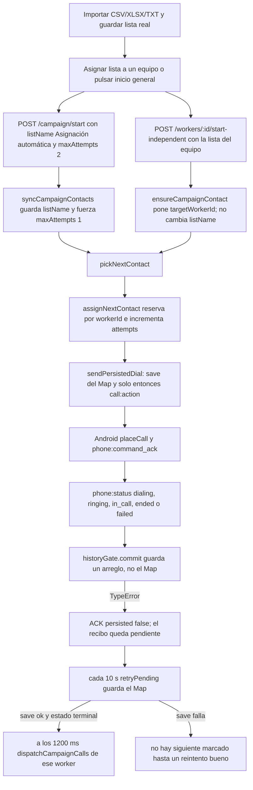

# Informe de concurrencia de llamadas

## Actualización posterior de correcciones locales

El análisis de abajo documenta el estado encontrado antes de iniciar las correcciones. Con autorización del usuario se aplicaron cambios locales, aún no desplegados. Validación local ejecutada el 2026-11-19:

- `CallHistoryGate.commit()` ahora pasa el `Map` de sesiones y el código afectado a persistencia; rechaza el commit si la sesión ya no existe.
- Los nombres agregados `Asignación automática` y `Pendientes del turno` ya no se comparan como nombres literales de lista.
- El inicio general conserva `maxAttempts` enviado por el panel.
- Los estados de llamada solo se marcan procesados después de persistirse.
- Una desconexión ya no libera automáticamente la propiedad de contactos pendientes ni convierte una llamada activa en terminal por timeout. El watchdog conserva la asignación hasta que Android confirme un terminal correlacionado, evitando un posible marcado duplicado si la llamada física sigue activa.
- La caché de intentos se invalida con revisiones de los intentos/sesiones y conserva solo una fotografía, en vez de acumular todas las fotografías antiguas en memoria.
- Los guardados dirigidos limpian la marca de sesión sucia solo si no apareció una mutación nueva mientras el guardado estaba en curso.
- Los logs de persistencia ahora registran el tamaño serializado, el tiempo de construir el snapshot y la espera en la cola; la consulta de la libreta registra el tiempo de consulta y cálculo de progreso. Estos datos sirven para medir, pero no se han recolectado en producción.
- En un mismo ciclo de despacho, se calcula una sola vez el historial de llamadas y la lista de bloqueos; cada teléfono recién asignado se agrega al filtro para conservar la prevención de duplicados entre equipos. La selección de pendiente/reintento ahora hace una pasada priorizada en vez de búsquedas separadas. Se agregaron logs lentos para `allCallAttempts()` y el ciclo de despacho (umbral 100 ms), sin números telefónicos ni IDs personales.
- Las mutaciones locales de una sesión ahora pasan su código a `saveSoon()` y las rutas síncronas de sesión/campaña guardan solo esa sesión. Si se mezcla una mutación sin alcance único en la misma ventana de 150 ms, se mantiene el snapshot completo. La escritura de llamadas sigue esperando MySQL y `saveChain` continúa serializando transacciones para preservar el orden.
- La tabla de contactos pagina a 100 filas; se removió la reconstrucción de un mapa no utilizado por fila. La sincronización de resultados y la asignación de listas ahora usan mapas/conteos lineales; las tablas de pendientes por equipo también paginan a 100 y evitan `includes`/`indexOf` dentro de recorridos grandes.
- Los snapshots de campaña omiten `attemptHistory` anidado y limitan `history` a los 100 intentos recientes; los reportes completos se cargan por el endpoint de intentos cuando el usuario abre o exporta reportes. El cálculo de bloqueos anuales se cachea mientras no cambie la foto de intentos y se invalida al alcanzar la expiración más próxima.
- El progreso de la libreta lee de MySQL solo teléfono, duración y resultado del intento, en lugar de transferir y parsear cada `row_data` JSON; además reutiliza el mapa de bloqueos anuales cacheado.
- Si falla el guardado previo al marcado, el mismo `callId`/`commandId` queda reservado y reintenta persistencia con backoff exponencial hasta guardar o hasta que cambie/finalice la asignación. La orden solo se emite tras guardar. La espera por un worker desconectado también conserva la reserva y reintenta con backoff, sin liberar la llamada por timeout.

- `npm test`: 88 aprobadas, 1 fallida, 1 omitida. El fallo está en `backend/__tests__/architecture/frontend.test.js`: espera 23 imports CSS y encuentra 1 en `frontend/shared/styles/base.css`. No está relacionado con esta corrección. La prueba omitida requiere `WORKSPACE_MYSQL_TEST=1`; no se activó porque esta validación no debía tocar ninguna base.
- Pruebas enfocadas de campañas: 19/19 aprobadas. La simulación nueva inyecta dos fallos de persistencia, comprueba backoff de 1 y 2 segundos y verifica que la orden salga una sola vez con el mismo identificador después del guardado; también verifica que una asignación cancelada no se envíe. Las pruebas sintéticas de progreso compacto y snapshots siguen pasando.
- Android: `:app:assembleDebug testDebugUnitTest` con JDK 17 terminó con `BUILD SUCCESSFUL`; se generó `android-app/app/build/outputs/apk/debug/VOIP-VC-debug.apk` (aprox. 87 MB). Gradle reportó avisos de APIs obsoletas para Gradle 9, sin impedir este build.
- `git diff --check` no reportó errores de whitespace. No se hicieron llamadas reales, no se conectó a MySQL y no se desplegaron estos cambios.

Esta validación no mide latencia real con miles de contactos ni simula reconexiones Android/Socket.IO contra servicios vivos. Para comprobar estabilidad de llamadas se necesita después una restauración aislada del dump y una prueba de carga controlada, sin usar la BD productiva.

## Preparación de migración relacional para EasyPanel

Se preparó código local para separar `contactBook` de `sessions.data` mediante `vc_contact_book_meta` y `vc_contact_book_contacts`, conservando el orden de los contactos. La ejecución al arranque está desactivada por defecto; requiere `AUTO_NORMALIZE_CONTACT_BOOKS=1` y la confirmación `CONTACT_BOOK_MIGRATION_BACKUP_VERIFIED=1`. Copia y eliminación del JSON ocurren en una sola transacción; se valida el conteo antes de confirmar. Se añadió `npm run rollback:contact-books`, que requiere la aplicación detenida y vuelve a insertar las libretas en `sessions.data` antes de limpiar las filas normalizadas.

Esta migración no se ejecutó ni se probó contra una base. Tampoco se ha comprobado la restauración del dump. No configurar las variables ni desplegar la migración hasta restaurar `llamadas1 (1).sql` en una base separada y verificar su contenido. La ruta HTTP de la libreta todavía entrega la libreta completa; la paginación para acelerar la carga inicial del navegador queda como fase siguiente.

## Cuellos adicionales: navegador, eventos y reportes

Auditoría estática adicional; no se midió con perfiles de navegador ni con tráfico de producción.

| Prioridad | Hallazgo confirmado por código | Posible impacto |
| --- | --- | --- |
| Alta | **Hallazgo de la auditoría anterior, ya parcialmente corregido:** `PAGE_SIZE` ahora es 100 (`frontend/app/dashboard-state.js:35`) y `contacts-view.js` crea filas solo para la página visible (`:79-80`), pero sigue filtrando toda la libreta en memoria por render (`:66-68`). | El DOM baja de hasta 10,000 filas a 100. La descarga y filtrado de toda la libreta y los recorridos completos siguen creciendo con el tamaño de la lista. |
| Alta | `campaign:state` incluye la campaña completa: `getCampaignSnapshot()` devuelve `contacts`, `callbacks` e `history`, y `emitCampaignState()` la difunde al room. El navegador recibe el evento, sincroniza resultados y vuelve a renderizar contactos. | Payload repetido grande por evento y trabajo de UI durante llamadas; posible demora al manejar controles del panel. No prueba por sí solo que el backend deje de despachar. |
| Alta | `syncCampaignResultsToContacts()` busca cada resultado con `Contacts.contacts.find(...)`, lo que puede comparar cada contacto de campaña contra toda la libreta. También `contacts-view.js` llama `getCampaignContactMap()` dentro del bucle de filas y descarta el resultado; esa función vuelve a construir el mapa completo. | Trabajo cuadrático potencial cuando hay muchos contactos, repetido al llegar eventos de campaña. La llamada al mapa es trabajo inútil confirmado; el costo efectivo depende de tamaños reales. |
| Media-alta | `emitState()` incluye `callRestrictions`; `callRestrictions()` vuelve a ejecutar `annualPhoneBlocks(allCallAttempts())` y recorre contactos de libreta/campaña. `refreshGlobalCallRestrictions()` emite estado a las otras sesiones. | Un cambio de estado puede volver a recorrer el historial global y multiplicar el cálculo por sesiones; candidato directo a retrasar la ruta de eventos en backend. Falta medir duración y frecuencia real. |
| Media | `GET /api/session/:code/contact-book` consulta todo el historial de intentos de esa sesión, obtiene también intentos globales y genera progreso de la libreta completa. En las rutas de red la respuesta se pagina después de filtrar la libreta completa en memoria. | La migración del JSON reduce escrituras, pero no vuelve paginada la lectura ni reduce por sí sola el procesamiento de progreso. |
| Media | `/api/reports/all` ejecuta `reportData()` sesión por sesión; cada llamada vuelve a calcular bloqueos anuales sobre los intentos globales. En continuar reporte, `annualBlock()` se invoca para cada contacto candidato. | Los reportes administrativos pueden tardar mucho al crecer historial × sesiones × contactos; efecto distinto del despacho de llamadas. |
| Baja-media | `startCampaignRun()` calcula `orderedLists` buscando contactos por cada lista, pero no usa la variable después. | Recorrido innecesario de contactos al iniciar; su costo crece con cantidad de listas y contactos. |

El monitor de red usa una cola de snapshots, refresca historiales cacheados cada 5 segundos y publica cada 30 segundos por defecto. Solo registra hasta 10 equipos, así que parece de menor prioridad que el render de contactos y los eventos completos, salvo que el panel administrativo también se sienta lento.

**Revalidación actual de la ruta UI/eventos:** `campaign:state` sigue mandando todos los contactos de la campaña (aunque ya excluye `attemptHistory` y recorta el historial a 100) (`backend/services/campaigns/campaign-manager.js:267-318`, `backend/session/session-lifecycle.js:40-45`). Cada recepción crea un `Map` de toda la libreta, recorre todos los contactos de campaña y renderiza panel y contactos (`frontend/app/dashboard-events.js:119-130`, `frontend/features/campaigns/campaign-controller.js:316-329`). Además, `state:changed` calcula `callRestrictions` recorriendo contactos de la libreta y campaña (`backend/session/session-state.js:130-145`, `backend/services/calls/restrictions.js:117-129`). Son recorridos y payload completos confirmados por código; no se midió su coste real. La mejora de 100 filas limita DOM, pero no hace paginada la API ni la sincronización de estado.

### Siguiente medición recomendada

Registrar tamaño en bytes y duración al serializar `campaign:state` y `state:changed`; duración de `callRestrictions()`; duración del handler del evento `campaign:state` en navegador; y cantidad de contactos renderizados por actualización. Comparar con 100, 1,000 y 10,000 contactos en una base restaurada de prueba. Después priorizar virtualización/paginación de tabla, índices `Map` reutilizados en el navegador y carga SQL paginada real. No se debe saltar el guardado duradero de intentos ni emitir llamadas antes del commit.

## Revisión local de `llamadas1 (1).sql`

Se revisó el dump sin imprimir ni copiar valores personales: mide 49,075,922 bytes (46.8 MiB). Aproximadamente 46.27 MiB del texto de inserciones pertenecen a `sessions`; la sentencia de inserción más grande ocupa aproximadamente 23.74 MiB. El dump contiene 5 sentencias `INSERT` para esa tabla. Estas cifras describen el archivo SQL local, no el tamaño físico exacto de MySQL ni una medición de latencia.

La concentración en `sessions` coincide con el diseño actual: `sessions.data` contiene la libreta y la campaña, y el guardado compara y actualiza la columna completa cuando cambia la sesión. Esto hace probable una amplificación importante de CPU, transferencia y escritura en las rutas de guardado; no demuestra por sí solo la latencia observada en producción ni el crecimiento de binlogs. La restauración del dump no se probó.

Auditoría estática del árbol de trabajo de este repositorio. No se modificó la aplicación, no se llamó a ningún teléfono, no se tocó MySQL ni se desplegó la APK. Los tamaños de `llamadas1`, de los JSON de `sessions` y de los binlogs son antecedentes comunicados, no mediciones de esta pasada.

## 1. Resumen ejecutivo y alcance

El síntoma pedido es: tras unas 10–20 llamadas, uno o más Xiaomi dejan de marcar, a veces mientras otro sigue, incluso con listas distintas. En este código no existe un tope de 10 ni de 20 contactos. Lo que sí está escrito es un guardado que siempre falla en el camino directo, un reintento que puede reanudar la cola con retraso, y un filtro que puede impedir el marcado desde el inicio.

Revisión de esta pasada, solo lectura, sobre el árbol actual (`package.json` versión `0.1.0`). Se reprodujo en Node el `TypeError` del bucle de `save` con un arreglo de un objeto. No se llamó a ningún teléfono, no se tocó MySQL y no se modificó la aplicación.

1. Cada `phone:status` llama a `persistence.save` con un arreglo. `save` solo acepta un `Map` y lanza `TypeError` antes de escribir. El marcado siguiente vive en el callback de ese `commit`. Ese callback no corre en el camino directo. Sí puede correr hasta 10 s después: `retryPending` guarda el `Map` real y entonces ejecuta los recibos pendientes (`runtime-lifecycle.js:82-84`, `call-history-gate.js:47-55`). En un proceso vivo la cola no queda cortada en el primer estado; queda retrasada y el ACK sale con `persisted: false`.
2. El inicio general nombra la campaña `Asignación automática`, y el selector solo toma contactos cuya lista se llama exactamente así. Las listas reales no coinciden. Ese inicio no puede elegir el contacto siguiente. El inicio por equipo no borra ese nombre: si el general ya corrió, el filtro sigue vacío también para el equipo.

El patrón “funciona 10–20 veces y luego se congela” no quedó reproducido. El defecto 1 no explica un corte exactamente en la llamada 10. Puede explicar pausas de unos 10 s más el tiempo de reescribir el JSON, y una parada real solo si el `save` del reintento también falla. La cesión de lista al desconectar sigue siendo la explicación de código más cercana a “un equipo sigue y el otro no”.

Alcance leído: importación en `frontend/features/contacts/import/import-actions.js`, inicio general y por equipo, `backend/services/campaigns/campaign-manager.js`, `backend/services/calls/dispatcher.js`, `backend/shared/persistence.js`, `backend/services/calls/call-history-gate.js`, `backend/sockets/call-events.js`, `backend/sockets/utility-events.js` y `android-app/app/src/main/java/com/voipvc/bridge/BridgeService.kt`. Versión del paquete: `0.1.0`. No hay prueba automática de `pickNextContact` ni del argumento que `commit` pasa a `save`.

## 2. Mapa de flujo

Límites de exclusión que sí existen:

| Límite | Dónde | Efecto |
| --- | --- | --- |
| Global de proceso | `saveChain` en `backend/shared/persistence.js:30` y `:207` | Un guardado de cualquier sesión espera al anterior. Dos sesiones no escriben en paralelo. |
| Por sesión | `CallHistoryGate.serialize` en `backend/services/calls/call-history-gate.js:15` | Los `phone:status` de una sesión entran en fila. |
| Por worker | `campaign.assignments[workerId]` en `campaign-manager.js:448` | Un equipo no recibe otro contacto mientras conserve asignación. |
| Por dispositivo físico | `bindDeviceToPairingSlot` en `pairing-lifecycle.js:19` | El socket viejo del mismo slot se desconecta. No hay un candado entre sesiones distintas. |
| Por lista | solo si `campaign.listName` coincide con `contact.list` | No aísla las listas entre sí cuando el nombre de campaña es el rótulo general. |
| Campaña | una campaña `running` por sesión, tope 10000 contactos | `backend/routes/campaigns.js:50` y `:53` |

## 3. Matriz de conflictos

| ID | Severidad | Síntoma | Evidencia | Reproducción | Impacto | Confianza |
| --- | --- | --- | --- | --- | --- | --- |
| C1 | Crítica | Cada estado falla el guardado directo y el siguiente marcado espera el reintento | `call-history-gate.js:39` pasa `[session]` a `save`. `persistence.js:201` hace `for (const [code, session] of sessionsMap)`. Un arreglo de un objeto lanza `TypeError` porque el objeto no es iterable. El siguiente despacho está en `call-events.js:282-283`, dentro del callback de `commit` (`call-history-gate.js:41`). `retryPending` (`call-history-gate.js:47-55`) sí llama a `save(this.getSessions())` y luego `flush`. El intervalo es 10 s (`runtime-lifecycle.js:82-84`). | Reproducido el `TypeError` con el mismo `for...of` sobre un arreglo de un objeto. No se levantó el servidor ni se hizo una llamada. | El ACK sale al momento con `persisted: false` (`call-events.js:293-296`). Android no se detiene por ese ACK: solo limpia el tracking si `accepted` y `terminal` (`BridgeService.kt:499-506`), y también al observar `ended` o `failed` (`BridgeService.kt:1110-1112`). En proceso vivo el siguiente marcado sale tras el reintento bueno más 1200 ms. Al arrancar, las asignaciones abiertas pasan a `retry_pending` (`runtime-lifecycle.js:63-72` llama a `skipActiveContact`). Ya no quedan tomadas por un reinicio. | Confirmado por código y por la prueba de lenguaje. El retraso, no el corte eterno, es lo que este árbol hace. No reproducido con teléfonos. |
| C2 | Crítica | El inicio general no marca, o marca cero | `campaign-controller.js:224-236` envía `listName = "Asignación automática"`. `campaigns.js:70-72` lo guarda. `campaign-manager.js:420` exige `contact.list === campaign.listName`. Los contactos llevan la lista del archivo (`import-actions.js:56-58`, `contacts-repository.js:370`). | No ejecutada. El predicado no tiene excepción para ese rótulo. | `dispatched.length` queda en 0. La UI dice que ningún equipo estaba disponible (`campaign-controller.js:250-252`), que no es la causa. | Confirmado por código. No reproducido en UI. |
| C3 | Alta | Un Xiaomi se queda con la lista de otro | `dispatcher.js:175-179` borra `targetWorkerId` de pendientes cuyo worker no está en el conjunto conectado. `campaign-manager.js:417-418` activa `targetedMode` si cualquier contacto tiene dueño. `campaign-manager.js:427-435` entrega la lista entera sin dueño al primer worker que se queda sin contactos propios. | No ejecutada. | Un corte de socket, aunque sea corto, suelta la lista. El otro equipo la absorbe. El primero, al volver, ya no tiene contactos con su id. | Confirmado por código. La frecuencia del corte es hipótesis. |
| C4 | Alta | Reintento distinto al que muestra el panel | El panel envía `maxAttempts: 2` (`campaign-controller.js:236`, `shift-actions.js:34`). `campaigns.js:72` escribe `maxAttempts: 1`. `campaign-manager.js:677-686`: si `attempts < maxAttempts` pasa a `retry_pending`; si no, a `failed`. | No ejecutada. | Un no contesta cierra el contacto en el primer intento. No explica por sí solo una pausa a mitad de lista. | Confirmado por código. |
| C5 | Alta | Todos los equipos esperan la misma escritura | `sendPersistedDial` espera `persistence.save` de la sesión completa antes de `call:action` (`dispatcher.js:40-75`). `save` clona la sesión con `JSON.parse(JSON.stringify)` (`persistence.js:205`) y reescribe la fila JSON (`persistence.js:262-264`). `saveChain` es una sola promesa del proceso (`persistence.js:207-217`). `saveSoon` dispara a los 150 ms (`session-state.js:42-58`) y, si no hay códigos sucios, guarda todas las sesiones. | No medida. | Con JSON de decenas de MB, cada estado y cada marcado reescriben la fila. Dos a seis teléfonos, y también dos sesiones, se serializan. Puede parecer que uno llama y el otro se paraliza. Un `UPDATE` largo no tiene tope de tiempo de consulta, solo `connectTimeout` de 10 s (`persistence.js:22`). | Mecanismo confirmado. La relación con los ~76 GB de binlogs es correlación, no causalidad medida. |
| C6 | Media | El equipo queda en `dialing` aunque Android rechazó la orden | `phone:command_ack` solo registra y reenvía (`call-events.js:310-330`). No suelta la asignación ni pide otro contacto. Android rechaza si `activeCommandId` sigue puesto (`BridgeService.kt:640-643`). El backend ya puso `worker.callState = "dialing"` y la asignación (`dispatcher.js:196-212`). El filtro de `dispatcher.js:187-188` exige estado `idle`, `ended`, `failed` o `available` y asignación vacía. | No ejecutada. | El rechazo no recupera la cola. El teléfono local sí limpia el tracking al observar `ended` o `failed` (`BridgeService.kt:1098-1112`), así que el rechazo permanente depende de que ese estado físico no llegue. | Confirmado por código. |
| C7 | Media | Al caer el socket no hay siguiente llamada | Si el worker sigue en `dialing`, `ringing` o `in_call` a los 12 s, `utility-events.js:184-197` marca `ended` y no llama a `dispatchCampaignCalls`. | No ejecutada. | El contacto puede cerrarse y el equipo quedarse en `idle` sin continuar la lista. | Confirmado por código. |
| C8 | Baja | El mismo aparato en dos sesiones | El reemplazo de slot es por sesión (`pairing-lifecycle.js:19-31`). No hay índice global de `deviceId`. | No ejecutada. | Dos sesiones podrían ordenar el mismo Xiaomi. | Hipótesis. No hay evidencia de que ocurra en este árbol. |
| C9 | Informativa | No hay tope 10–20 | El tope de campaña es 10000 (`campaigns.js:53`). El archivo de reportes recorta a 100 (`dispatcher.js:269-271`). Hay hasta 20 QR por sesión (`devices.js:75`), que es un tope de equipos, no de llamadas. Android usa 10 s sin estado Telecom (`BridgeService.kt:697-710`), 20 s y 40 s de marcado (`BridgeService.kt:1073-1085`) y latido de 10 s (`BridgeService.kt:1357-1382`). | Búsqueda estática. | Esos números son tiempos por llamada o cupos de equipos, no un contador de contactos. | Confirmado que no hay ese contador. |
| C10 | Media | El bloqueo anual puede usar una foto vieja de intentos | `restrictions.js:12-21` arma la clave de caché con `Object.keys(runtime.persistence.records)`. `records` es un `Map`; `Object.keys` de un `Map` devuelve `[]`. La clave queda fija mientras no cambie el número de sesiones. `clearAllCallAttemptsCache` (`restrictions.js:24`) no tiene ningún llamador. | Reproducido: `Object.keys(new Map([["a",1]]))` tiene longitud 0. | `excludeCalledPending` (`contact-book.js:88-105`) puede no ver intentos nuevos y volver a marcar el mismo teléfono en otro contacto, o seguir usando la primera foto. No explica una parada a las 10–20 llamadas. | Confirmado por código. No ejecutado contra una campaña. |

### Revalidación de la matriz contra el árbol actual (2026-11-19)

La matriz C1–C10 de arriba pertenece a una revisión anterior y no debe tomarse como estado actual sin esta revalidación. Encontré varios hallazgos ya corregidos, y dos riesgos nuevos/parcialmente vigentes:

| ID previo | Estado actual | Evidencia revalidada |
| --- | --- | --- |
| C1 | Corregido; la reproducción anterior quedó obsoleta. | `CallHistoryGate.commit()` pasa el `Map` de sesiones y el arreglo de códigos cambiados a `persistence.save(sessions,[code])` (`backend/services/calls/call-history-gate.js:35-41`), no un arreglo de sesión. |
| C2 | Corregido. | `pickNextContact()` trata `Asignación automática` y `Pendientes del turno` como campañas agregadas sin filtro literal de lista (`backend/services/campaigns/campaign-manager.js:433-442`). |
| C3 | La liberación al desconectar ya no está presente. Persiste el reparto dinámico de contactos sin dueño. | `dispatcher.js` no borra `targetWorkerId` al desconectar. `pickNextContact()` aún permite que un worker reclame una lista completa sin dueño cuando no tiene contactos elegibles (`campaign-manager.js:455-466`); el efecto de concurrencia depende de cómo se formen los contactos sin dueño. |
| C4 | Corregido para los inicios del panel. | El panel manda `maxAttempts: 2` y la ruta respeta `req.body?.maxAttempts ?? 1` (`frontend/features/campaigns/campaign-controller.js:235`, `backend/routes/campaigns.js:70-73`). |
| C5 | Mitigado parcialmente; sigue siendo riesgo medible. | Guardados dirigidos y separación de la libreta reducen trabajo, pero `saveChain` todavía serializa cada escritura (`persistence.js:397-405`) y los estados de llamada confirman el snapshot de sesión antes del ACK (`call-events.js:244-269`). Si una sesión conserva una campaña grande en `sessions.data`, los cambios de estado pueden seguir esperando un `UPDATE` grande. No se midió latencia actual. |
| C6–C7 | La matriz anterior mezclaba rechazo de comando con desconexión; no confirma una parada por sí sola. | Android manda `failed` ante error de marcado (`BridgeService.kt:677-735`) y al reconectar anuncia su estado local (`:387-405`); el backend conserva asignaciones cuando no hay terminal físico (`utility-events.js:183-193`). El ACK de comando solo se reenvía al panel (`call-events.js:312-333`), así que un ACK negativo sin un `phone:status` correlacionado no libera la asignación. Falta reproducir ese caso. |
| C8 | Riesgo estructural presente, ocurrencia desconocida. | El enlace de dispositivo y deduplicación de slots operan sobre una sola sesión (`backend/services/calls/pairing-lifecycle.js:15-37,40-62`); `session:join` busca el worker solo en la sesión indicada (`backend/sockets/workspace-events.js:94-109,152-174`). No aparece un registro global de `deviceId`; falta saber si el mismo ID puede autenticarse en dos sesiones en uso real. |
| C9 | Sigue confirmado: no existe tope de 10–20 llamadas. | El límite de campaña continúa siendo 10,000 contactos (`backend/routes/campaigns.js:53-54`); los otros valores citados son timeouts/cupos. |
| C10 | Corregido. | `allCallAttempts()` usa `persistence.attemptsRevision` y revisiones de sesión en la clave (`backend/services/calls/restrictions.js:16-36`); `remember()` incrementa `attemptsRevision` cuando cambia una fila (`backend/shared/persistence.js:98-106`). La caché anual se recalcula al cambiar la referencia de intentos o vencer el siguiente bloqueo (`restrictions.js:47-60`). |

### Hallazgo nuevo: fallo del guardado previo al envío puede dejar una reserva huérfana

**Confirmado por código, sin reproducción con MySQL:** `dispatchCampaignCalls()` asigna el contacto al worker y establece estados `dialing` antes de invocar `sendPersistedDial()` (`backend/services/calls/dispatcher.js:188-213`). Si `persistence.save()` falla, `sendPersistedDial()` captura el error, muestra `call:error` y termina sin emitir `call:action` (`dispatcher.js:38-56`). No libera ni revierte la asignación. Las llamadas de reintento de `scheduleDialRetry()` solo cubren al worker desconectado (`dispatcher.js:60-103`), no el error de persistencia. Un siguiente despacho excluye al worker porque tiene asignación activa (`dispatcher.js:176-186`). El reintento general de persistencia cada 10 segundos no tiene recibo asociado al envío de esa orden (`runtime-lifecycle.js:85-87`).

El impacto esperado era una campaña que dejaba de avanzar en ese worker tras una falla temporal de MySQL, aunque Android nunca recibiera la orden. **Corregido localmente:** se conserva “persistir antes de marcar”; los errores previos al emit programan un reintento con backoff hasta que el intento ya no esté asignado o el historial indique que terminó. La orden conserva `commandId`/`callId` y solo sale después del guardado exitoso. La prueba sintética cubre varios fallos seguidos, recuperación, orden de persistencia/emisión y cancelación. No se validó con una transacción MySQL real.

### Riesgo adicional de reinicio y correlación

El arranque convierte las asignaciones activas en `retry_pending` inmediatamente (`backend/lifecycle/runtime-lifecycle.js:66-76`). Android persiste su `activeCommandId`/`callId` local y emite el estado físico al reconectar (`BridgeService.kt:1153-1169`, `:387-405`). **Riesgo inferido, no reproducido:** si la llamada física sigue activa durante un reinicio del backend, el nuevo ciclo podría haber liberado la asignación y permitir una nueva reserva antes de reconciliar el estado local del teléfono. Debe probarse con reinicio durante `dialing`/`in_call`, incluyendo orden de eventos y correlación por `callId`; no se debe cambiar esa recuperación hasta confirmar el comportamiento en simulación controlada.

En esta pasada sí se cambió la lógica local del despacho y se añadieron pruebas unitarias. No se conectó MySQL, no se enviaron órdenes Socket.IO a dispositivos y no se hicieron llamadas. El riesgo de reinicio y la latencia de payloads siguen sin reproducirse contra un entorno aislado.

## 4. Listas generales, listas exclusivas y 2 a 6 Xiaomi

Inicio general (`campaign-controller.js:212-246`): filtra contactos elegibles y les asigna dueño solo cuando la lista está asociada a un equipo; los demás quedan sin dueño. El backend ahora trata `Asignación automática` y `Pendientes del turno` como campañas agregadas (`campaign-manager.js:433-442`), por lo que contactos de listas reales sí pueden seleccionarse.

En una campaña dirigida, cada worker recibe contactos con su `targetWorkerId`. Al agotarlos, `pickNextContact()` puede reclamar todos los contactos aún sin dueño de una lista (`campaign-manager.js:455-466`). Esto permite trabajo sobre listas sin asignar, pero un worker puede apropiarse de esa lista completa; es comportamiento confirmado, no un cambio silencioso de propietarios desconectados. Los propietarios explícitos no se eliminan al desconectar el socket. Por eso los pendientes dirigidos a un worker desconectado quedan esperando a ese worker, lo cual prioriza evitar interferencia entre equipos.

El inicio por equipo manda una selección dirigida y el panel comparte una campaña y el mapa `assignments`; no existen colas persistentes independientes por dispositivo. `switchWorkerList` cambia la propiedad de contactos pendientes del worker que solicita el cambio y asigna los de la lista destino (`campaign-manager.js:609-650`); la concurrencia de esta operación debe cubrirse con prueba de dos equipos antes de modificarla.

El modo general y el modo por equipo comparten una sola campaña y un solo objeto `assignments`. No hay seis colas independientes.

## 5. MySQL, colas y binlogs

Qué hace cada marcado y cada estado:

1. `sendPersistedDial` pide guardar solo la sesión afectada antes de emitir `call:action` (`dispatcher.js:33-56`, `persistence.js:397-405`). Si falla el guardado, ahora reintenta con backoff y conserva los mismos IDs; una prueba unitaria simula fallos y recuperación.
2. `saveNow` abre transacción, lee y compara la fila, y actualiza `sessions.data` completa si cambió (`persistence.js:446-505`). Si la libreta está normalizada, se excluye del JSON de sesión; campañas de hasta 10,000 contactos y otros datos aún pueden permanecer en la fila.
3. Los intentos sucios se escriben en `vc_call_attempts` dentro de esa transacción (`persistence.js:496-505`). `saveChain` es global al proceso, por lo que operaciones de distintas sesiones pueden esperar en serie (`persistence.js:397-405`).
4. `phone:status` se procesa en serie por sesión y espera un guardado durable antes del ACK y del siguiente despacho (`call-events.js:167-168,256-285`; `call-history-gate.js:15-47`). El callback de recepción posterior al commit no contiene el error de tipo descrito en la matriz vieja.

`historyGate.blocked` actualmente devuelve `false` (`call-history-gate.js:12-14`), así que esa comprobación no frena despacho. La seguridad del envío se apoya en esperar `persistence.save()` y no en ese flag.

No se midió `persistMs`, ni bytes por escritura, ni binlog por hora. El mecanismo alcanza para hacer crecer el binlog si el formato es por filas y la columna JSON se reescribe entera en cada estado: el binlog guarda la imagen de la fila, no el diff del contacto. Los ~18 MB y ~20 MB citados harían cada `UPDATE` muy caro. No está demostrado que esas dos filas hayan producido los ~76 GB. Tampoco se demostró que el purgado a 3 días haya quitado la causa; solo el síntoma de disco. No hay respaldo externo en este árbol que se pueda dar por verificado.

`lastSnapshot` se sustituye por el snapshot parcial del `save` (`persistence.js:237`). Un guardado de una sola sesión deja el respaldo en memoria sin las demás. Eso afecta a `backup()`, no a la tabla, porque cada fila se escribe por su código.

La comparación `JSON.stringify(existingData) === JSON.stringify(data)` (`persistence.js:261`) puede fallar por el orden de claves que devuelve el driver y forzar una reescritura aunque el contenido sea el mismo. Es hipótesis, no se ejecutó contra MySQL.

## 6. Android, aparte del backend

`call:action` llega a `BridgeService.kt:519`. `dial` deduplica por `commandId` (`:540-557`) y llama a `TelecomManager.placeCall` (`:686-691`). El envío no usa ACK de Socket.IO; Android manda `phone:command_ack` (`BridgeService.kt:1458-1469`) y el servidor lo reenvía al dashboard (`call-events.js:312-333`). Los errores de marcado también producen un `phone:status` terminal correlacionado (`BridgeService.kt:731-737`); si el ACK negativo llega sin ese estado, el backend no tiene actualmente una reconciliación automática por ACK.

Estados físicos: `dialing`, `ringing`, `in_call`, `ended`, `failed`. Un `idle` de campaña se informa como `ended` si había llamada de campaña (`BridgeService.kt:1054`). El backend solo suelta al worker con `ended` o `failed` mientras el contacto sigue en estado activo (`campaign-manager.js:660`). Un `idle` sin `terminalConfirmed` no libera (`call-events.js:224` y `campaign-manager.js:657-659`).

Buzón: `detectedVoicemail` y `detectedAnnouncement` viajan en `phone:status` (`BridgeService.kt:1547-1549`). El backend anota `buzon_de_voz` en el intento y solo cierra el contacto cuando llega el estado terminal (`campaign-manager.js:637-670`). Shizuku y Vosk no participan en la decisión de soltar la cola. Si el buzón se detecta y el `ended` no llega, el worker sigue ocupado por la regla de estado terminal, no por el reconocedor.

Latido: ping cada 10 s; si el pong tarda más de 5 s, el teléfono corta el socket (`BridgeService.kt:1377-1382`). Un `save` lento puede alargar el pong. Es una hipótesis de desconexión, no una prueba de que el latido sea la causa de las paradas.

Recuperación: al reconectar se reemite el último estado (`BridgeService.kt:480-484`). El tracking se limpia en el teléfono al ver el fin (`:1110-1112`) y también si el ACK dice `accepted` y `terminal` (`:499-506`). El servidor no vuelve a marcar por ese ACK.

## 7. Correcciones por fases

No implementar hasta aprobación explícita. Hace falta un respaldo externo verificable antes de cualquier escritura de reparación.

Fase 1, sin cambiar la durabilidad del intento:

- `commit` debe guardar `this.getSessions()` o un `Map` con el código real, y pasar el código en `changedCodes`. Hoy el arreglo ni identifica la sesión ni es iterable como pares. El reintento de 10 s no sustituye ese arreglo: llega tarde y reescribe todas las sesiones.
- El siguiente marcado debe seguir esperando a que ese `save` confirme. No emitir `call:action` ni avanzar la cola si el guardado falla.
- Tratar `Asignación automática` como “sin filtro de lista”. El filtro literal solo debe aplicarse cuando `listName` es una lista real, como `Pendientes del turno` si esa lista también existe en los contactos. Hoy `Pendientes del turno` tiene el mismo problema: los contactos conservan su lista original (`shift-actions.js:39`) y el filtro exige igualdad (`campaign-manager.js:420`).
- Dejar de borrar `targetWorkerId` por no aparecer en el snapshot de conectados. Una desconexión no transfiere la lista. La apropiación de `campaign-manager.js:427-435` no debe correr mientras el dueño anterior pueda reconectar.
- Una sola fuente para `maxAttempts`. El `1` fijo de `campaigns.js:72` ignora el `2` del panel.

Fase 2, después de medir una campaña de prueba:

- Seguir guardando el intento en `vc_call_attempts` dentro de la transacción. Reducir la reescritura del JSON de sesión a los campos que de verdad cambiaron, sin perder el orden de `saveChain` ni marcar un intento que no quedó escrito.
- Si Android responde `phone:command_ack` con `ok: false`, soltar la asignación solo cuando el estado físico no esté en llamada, y volver a encolar ese contacto sin sumar otro intento si `placeCall` no llegó a ocurrir.
- Al cumplirse la gracia de 12 s, programar el despacho de ese worker igual que hace el estado terminal.
- Pruebas de `pickNextContact`, de `commit` con `Map`, y de dos workers con listas distintas.

No conviene empezar por purgar binlogs, borrar sesiones ni tocar Shizuku.

## 8. Plan de pruebas

No se ejecutó ninguna. Resultados observados: solo el `TypeError` del bucle equivalente al de `save`. El resto es resultado esperado.

| Prueba | Esperado si el código sigue igual | Esperado después de la fase 1 |
| --- | --- | --- |
| 1 teléfono, 20 contactos, una lista, sin llamadas reales: simular `phone:status` `ended` | El `commit` falla. Si `retryPending` guarda el `Map`, el segundo `call:action` sale unos 10 s después. Si ese guardado falla, no hay segundo marcado | 20 marcados, un intento cada uno, sin duplicar `attemptId`, sin esperar el intervalo de reintento |
| 2 teléfonos, 2 listas, 20 contactos cada una | El inicio general marca 0. Si el general ya corrió, el inicio por equipo también marca 0. En una campaña nueva, el inicio por equipo marca y el siguiente espera el reintento de 10 s | Cada lista avanza solo en su equipo |
| 6 teléfonos | Misma parada, más espera en `saveChain` | Ningún equipo espera el estado de otro para elegir su propio contacto. La escritura sigue ordenada. |
| Cortar el socket durante `dialing` y reconectar antes de 12 s | La lista puede quedar sin dueño y pasar al otro equipo | La lista sigue en el equipo original |
| Perder el `ended` | El worker queda ocupado | Sigue ocupado hasta estado físico o hasta la gracia, y luego continúa sin duplicar |
| MySQL lento | `saveChain` retrasa a todas las sesiones. No se midió | Se registra `persistMs` y `queueWaitMs`. El marcado no sale antes del commit |
| Buzón | El contacto no se cierra hasta `ended` o `failed` | Igual. Shizuku no decide la cola |
| Mismo `deviceId` en dos sesiones | No hay candado global | Hay que añadir la prueba antes de afirmar que está prohibido |

Medidas a agregar en esa prueba, sin datos personales: `sessionCode`, `workerId`, `contactId`, `callId`, `commandId`, lista, `persistMs`, `queueWaitMs`, `dispatchMs`, tiempo hasta ACK, tiempo hasta terminal, `nextDialMs`, profundidad de `saveChain` y bytes de binlog por hora.

## 9. Respaldo, despliegue y rollback

No hay respaldo externo confirmado. No desplegar la corrección ni ejecutar una campaña de reparación sobre `llamadas1` hasta tener una copia restaurable y probada fuera de este servidor.

Despliegue propuesto, cuando se apruebe: primero el arreglo de `commit` y el filtro de lista, en un proceso nuevo, con las sesiones actuales solo en lectura. Verificar con la prueba de 2 teléfonos. Después el aislamiento de `targetWorkerId`. La reducción del JSON queda en una tercera salida.

Rollback: volver al build anterior del proceso Node. No hace falta migración de esquema para la fase 1. No borrar filas de `sessions` ni de `vc_call_attempts` para revertir. Si una campaña de prueba dejó asignaciones `dialing` huérfanas, el rollback de código no las limpia; hay que decidir un cierre explícito con el intento ya escrito, no un borrado.

## 10. Preguntas abiertas

- ¿El proceso que hoy llama en producción tiene este `call-history-gate.js:39` y este `retryPending` de 10 s? Más de una llamada automática no descarta este archivo: el reintento puede estar reanudando la cola.
- ¿Las pausas entre llamadas se acercan a 10 s más el tiempo de `persistMs`? Eso encajaría con C1 más C5. Un corte seco, sin otro marcado aunque MySQL responda, no encaja con este árbol.
- ¿El operador usa el botón general o el botón por equipo? El primero, en este árbol, no elige contactos.
- Tamaño real de cada `sessions.data`, frecuencia de `UPDATE` y `binlog_format` durante una campaña. Sin eso, los 76 GB siguen siendo correlación.
- Si el Xiaomi emite `ended` con el mismo `callId` de la asignación. Sin ese par, `updateActiveCallState` no suelta al worker (`campaign-manager.js:630` y `:636`).

## 11. Checklist de aceptación

- Cero llamadas duplicadas: un `attemptId` activo por contacto y un `commandId` no reutilizado para un `placeCall` nuevo.
- Cero contactos perdidos: un `pending` o `retry_pending` sigue elegible para su worker después de un fallo de guardado, y no pasa a otra lista.
- Progreso independiente: el estado de un Xiaomi no borra el `targetWorkerId` de otro ni elige contactos de su lista.
- Sin bloqueo indefinido: un terminal confirmado, o la gracia de desconexión, siempre programa el siguiente marcado de ese worker. Un `commit` fallido no deja la asignación tomada en memoria y abierta en MySQL.
- El panel y el servidor usan el mismo `maxAttempts`.
- Ningún marcado sale antes de que MySQL confirme el intento.

## Cierre

**Demostrado:** el guardado directo de `phone:status` no puede completar porque recibe un arreglo donde `save` exige un `Map`. El marcado siguiente no sale en ese callback; puede salir cuando `retryPending` guarda el `Map`, cada 10 s. El inicio general filtra por el nombre `Asignación automática` y no por las listas importadas, y ese nombre no lo limpia el inicio por equipo. El servidor fuerza un intento aunque el panel pide dos. Desconectar a un equipo puede soltar su lista y otro equipo se la queda entera. Todas las sesiones comparten `saveChain` y reescriben el JSON completo. La caché de intentos no ve las claves de un `Map`. Un reinicio ya devuelve la asignación abierta a `retry_pending`.

**No demostrado:** que el corte ocurra a las 10–20 llamadas, que los JSON grandes hayan generado los 76 GB, y que Shizuku, Vosk o la batería del Xiaomi sean la causa.

**Corregir primero:** el argumento de `commit`, el filtro del rótulo general y la cesión de lista al desconectar.

**No tocar todavía:** binlogs, borrado de sesiones, la APK, ni la regla de esperar el guardado antes de marcar.
