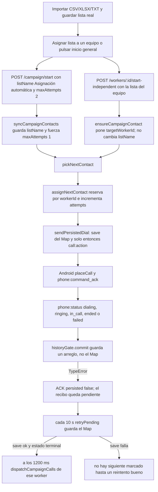

# Informe de concurrencia de llamadas

## Evidencia nueva y limpieza del VPS (2026-11-20)

La inspección y limpieza fueron autorizadas por el usuario. Se hizo respaldo lógico externo de la base antes de purgar binlogs. No se reiniciaron servicios ni se cambiaron filas de la aplicación.

### Hallazgos confirmados

- Antes de limpiar, el disco raíz tenía 94 GB usados de 96 GB (**98%**, 2.4 GB libres); 86 `binlog.*` sumaban unos 84 GB. Una purga inicial de 24 horas liberó solo ~1.3 GB; tras conservar seis horas, se observaron unos 35 GB de binlogs dentro de esa ventana. Finalmente, con la copia ya verificada en el VPS y sin réplicas, se purgó con SQL hasta conservar solo el binlog activo. Resultado: 11 GB usados de 96 (**11%**, 86 GB libres), dos archivos binlog de unos 8 KB en total.
- Configuración inicial: `log_bin=ON`, `binlog_format=ROW`, `binlog_row_image=FULL`, `max_binlog_size=1 GiB`, `binlog_expire_logs_seconds=259200` (3 días), `innodb_redo_log_capacity=100 MiB`. Con autorización, `binlog_expire_logs_seconds` quedó persistido en **21600 segundos (6 horas)**. `SHOW REPLICAS` y `SHOW REPLICA STATUS` devolvieron cero antes de purgar. La retención limita el crecimiento futuro, pero la generación observada requiere seguimiento.
- Respaldo lógico `llamadas1`: 62,020,458 bytes; `mysqldump` terminó con código 0, incluye 17 `CREATE TABLE`, marcador `Dump completed` y SHA-256 `C9B6C73816057ADB8418B7FF9DE2C77508B5AF366D701C1AF5079F7756A7A983`. Copia en el VPS: `/root/backups/llamadas1/llamadas1.sql` (modo 600, directorio 700); el hash coincide con la copia externa. El manifiesto incluye instrucciones y huellas. No se probó importar el dump: Docker Desktop local no estaba iniciado. El snapshot SQL corresponde a 2026-11-20 20:44:23 UTC; no incluye coordenadas para PITR desde binlogs.
- El contenedor MySQL mostró `Innodb_log_waits=0` y dos hilos ejecutándose en el instante de la consulta. Son valores puntuales; no invalidan las advertencias históricas `[MY-014089]` en las que el escritor de redo llegó al límite de 100 MiB.
- El código dentro del contenedor actual mantiene el flujo `phone:status` → `await historyGate.commit(...)` y actualiza el JSON completo de `sessions.data`. La imagen en producción no es byte por byte igual al workspace local (los SHA-256 de `call-events.js`, `persistence.js` y `call-history-gate.js` difieren); no se debe asumir que un cambio local ya está desplegado.
- La imagen actual tampoco contiene la optimización local `getPendingSessionCodes()` para limitar los reintentos de `retryPending()` a sesiones sucias. Esa optimización reduce reconstrucciones en el temporizador de recuperación, pero por sí sola no elimina el snapshot completo que se persiste por cada `phone:status`.
- Estado guardado al consultar: `venta1` figura **paused**, con 1,911 contactos (30 completados) y cero workers conectados. `venta2` figura **running**, con 5,525 contactos (190 completados, 221 fallidos) y un worker conectado en `ringing`; su último `updatedAt` guardado fue 2026-11-20 18:28:04Z. Otras dos sesiones guardadas figuran `running`, pero sin workers conectados. Esos estados provienen de snapshots en MySQL y pueden estar desactualizados; no prueban el estado físico actual del Xiaomi.
- `docker logs` no devolvió líneas de la app en la ventana reciente consultada. Por ello no hay evidencia de ese flujo de logs para fijar el último ACK o identificar quién pausó `venta1`; tampoco se debe interpretar el resultado vacío como prueba de que no hubo eventos si EasyPanel los recoge por otra vía.

### Causa más probable de la presión y relación con la parada

La ruta de `phone:status` modifica campos de sesión y espera el commit durable antes de enviar `phone:status_ack`; para un estado terminal, el siguiente despacho se programa después de ese commit. `CallHistoryGate` serializa eventos de una sesión y `SessionPersistence.save()` encadena escrituras con un `saveChain` global. `saveNow()` reemplaza `sessions.data` completo cuando detecta cambios. Como MySQL usa binlog por filas con imagen `FULL`, cada cambio de una fila JSON de hasta 32 MB puede producir mucho más binlog que el tamaño final de la tabla. La combinación encaja con los 84 GB observados, aunque no se midió una tasa de escritura ni cada evento de MySQL para cerrar la atribución exacta.

La presión del disco y las esperas del redo pueden alargar o fallar el commit que confirma los estados de Android y retrasa el siguiente marcado. Esto es un mecanismo demostrado por el orden del código y coherente con las advertencias y el tamaño de los binlogs; falta correlacionar un incidente concreto con `queueWaitMs`, `persistMs`, ACK y el historial horario de los binlogs. Para el snapshot actual de `venta1`, además, el motivo inmediato por el que no inicia es que la campaña está pausada y no tiene workers conectados. Para `venta2`, un estado guardado `ringing` sin terminal puede retener ese worker; hay que cotejarlo con Android antes de liberarlo o volver a marcar.

### Estado posterior a la limpieza y pendientes

- La purga se hizo por SQL de MySQL, que actualiza su índice; no se borraron archivos manualmente. Los contenedores de llamadas y MySQL siguieron arriba. No se alteró `innodb_redo_log_capacity`, no se desplegó código ni se ejecutó migración.
- El dump tiene cierre correcto y checksum, pero la importación de prueba queda pendiente. No se modificó la política de usuarios/grants de MySQL.
- Siguiente corrección: identificar el commit exacto de la imagen EasyPanel; probar restauración del dump en una instancia aislada; capturar el estado físico del worker `ringing`; diseñar persistencia incremental pequeña que conserve el intento durable y medir escritura/latencia antes de desplegar. Revisar el espacio nuevamente durante carga, porque el origen de los binlogs sigue activo en el código.

## Estado para continuar los fixes

Este informe es el resumen único de lo corregido y lo que falta. Los cambios descritos son locales; no están desplegados en EasyPanel ni se probaron contra la base productiva.

### Corregido localmente

- Las campañas agregadas aceptan contactos de sus listas reales y el backend respeta `maxAttempts` del panel.
- El estado de un worker desconectado ya no libera contactos asignados sin confirmar el fin físico de la llamada. Se evita ceder la lista silenciosamente a otro Xiaomi.
- La finalización espera persistencia antes de confirmar al teléfono y avanzar la cola; la caché de intentos se invalida por revisiones.
- Si MySQL falla antes de emitir una orden, el despacho reintenta el guardado con backoff y mantiene el mismo `callId`/`commandId`. La orden solo se emite después del guardado. Si el worker está desconectado, conserva la reserva y espera su reconexión.
- Los guardados locales de una sola sesión se acotan a esa sesión; se redujeron recorridos de contactos, el DOM de la libreta y las respuestas con historial de campaña. El progreso de la libreta puede consultar columnas compactas de intentos SQL.
- Se preparó la normalización de contactos a tablas MySQL con validación transaccional y rollback. **No se ejecutó**; no se migró a Supabase. MySQL sigue siendo el almacenamiento actual.

### Validación conocida

- Suite completa, ejecutada tras deduplicar: 89 aprobadas, 1 fallida y 1 omitida. La falla restante es el test de arquitectura CSS (espera 23 imports, encuentra 1); la omitida requiere conexión MySQL.
- Campañas: 20/20 pruebas enfocadas pasan, incluidas simulaciones de fallo/reintento de persistencia y reconexión. Contratos HTTP y campañas combinados: 22/22; incluyen las redirecciones de las rutas de imagen antiguas.
- Android: el build y `testDebugUnitTest` pasaron previamente con JDK 17; este último cambio solo toca backend e informe.
- No se conectó a ninguna base, no se enviaron órdenes a teléfonos y no se hicieron llamadas reales.

### Pendiente prioritario

1. Restaurar el dump en una base aislada y medir fallos/recuperación de MySQL, tamaño y duración de cada guardado.
2. Simular reconexión y reinicio del backend mientras Android está en `dialing` y `in_call`; confirmar reconciliación por `callId` sin duplicar una llamada.
3. Medir campañas de 100, 1,000 y 10,000 contactos. `campaign:state` todavía envía la campaña completa y la web vuelve a recorrer los contactos; falta reducir esos payloads y completar paginación real desde servidor.
4. Confirmar respaldo restaurable y rollback antes de habilitar la migración de contactos en EasyPanel. No desplegarla solo por tener el código preparado.
5. Verificar que el árbol local y la versión desplegada coincidan. Todavía no hay datos de latencia productiva que prueben cuánto explican estos cuellos.

### Limpieza realizada

- Se revisaron carpetas de pruebas: las siete suites Node se ejecutan con `npm test`; `android-app/app/src/test` corresponde a pruebas Gradle. No encontré carpetas de pruebas claramente abandonadas y las conservé.
- Revisión y deduplicación: de 71 flyers/miniaturas se encontró un solo par idéntico (`tienda-virtual-de-muebles-moderna.webp` / `tiendas-de-muebles.webp`, más sus miniaturas). Se retiró del catálogo la variante redundante y se borraron sus dos archivos, ahorrando 269,328 bytes (aprox. 263 KiB). Se añadieron redirecciones de las dos rutas antiguas a los assets canónicos para mantener imágenes de plantillas que ya estén guardadas en MySQL (`backend/routes/static.js`); la base no se modificó. El dump SQL no está disponible aquí para contar cuántas filas antiguas usan esa ruta. El logo, iconos de llamada e iconos Android tienen referencias activas.
- Se eliminó solo `.screenshots/.tmp`, que estaba vacío. Se conservaron `.local-test/sessions.json` y `android-app/import-backup` por si contienen datos de trabajo o recuperación.

## Actualización posterior de correcciones locales

El análisis de abajo documenta el estado encontrado antes de iniciar las correcciones. Con autorización del usuario se aplicaron cambios locales, aún no desplegados. Validación local ejecutada el 2026-11-19:

- `CallHistoryGate.commit()` ahora pasa el `Map` de sesiones y el código afectado a persistencia; rechaza el commit si la sesión ya no existe.
- Los nombres agregados `Asignación automática` y `Pendientes del turno` ya no se comparan como nombres literales de lista.
- El inicio general conserva `maxAttempts` enviado por el panel.
- Los estados de llamada solo se marcan procesados después de persistirse.
- Una desconexión ya no libera automáticamente la propiedad de contactos pendientes ni convierte una llamada activa en terminal por timeout. El watchdog conserva la asignación hasta que Android confirme un terminal correlacionado, evitando un posible marcado duplicado si la llamada física sigue activa.
- La caché de intentos se invalida con revisiones de los intentos/sesiones y conserva solo una fotografía, en vez de acumular todas las fotografías antiguas en memoria.
- Los guardados dirigidos limpian la marca de sesión sucia solo si no apareció una mutación nueva mientras el guardado estaba en curso.
- Los logs de persistencia ahora registran el tamaño serializado, el tiempo de construir el snapshot y la espera en la cola; la consulta de la libreta registra el tiempo de consulta y cálculo de progreso. Estos datos sirven para medir, pero no se han recolectado en producción.
- En un mismo ciclo de despacho, se calcula una sola vez el historial de llamadas y la lista de bloqueos; cada teléfono recién asignado se agrega al filtro para conservar la prevención de duplicados entre equipos. La selección de pendiente/reintento ahora hace una pasada priorizada en vez de búsquedas separadas. Se agregaron logs lentos para `allCallAttempts()` y el ciclo de despacho (umbral 100 ms), sin números telefónicos ni IDs personales.
- Las mutaciones locales de una sesión ahora pasan su código a `saveSoon()` y las rutas síncronas de sesión/campaña guardan solo esa sesión. Si se mezcla una mutación sin alcance único en la misma ventana de 150 ms, se mantiene el snapshot completo. La escritura de llamadas sigue esperando MySQL y `saveChain` continúa serializando transacciones para preservar el orden.
- La tabla de contactos pagina a 100 filas; se removió la reconstrucción de un mapa no utilizado por fila. La sincronización de resultados y la asignación de listas ahora usan mapas/conteos lineales; las tablas de pendientes por equipo también paginan a 100 y evitan `includes`/`indexOf` dentro de recorridos grandes.
- Los snapshots de campaña omiten `attemptHistory` anidado y limitan `history` a los 100 intentos recientes; los reportes completos se cargan por el endpoint de intentos cuando el usuario abre o exporta reportes. El cálculo de bloqueos anuales se cachea mientras no cambie la foto de intentos y se invalida al alcanzar la expiración más próxima.
- El progreso de la libreta lee de MySQL solo teléfono, duración y resultado del intento, en lugar de transferir y parsear cada `row_data` JSON; además reutiliza el mapa de bloqueos anuales cacheado.
- Si falla el guardado previo al marcado, el mismo `callId`/`commandId` queda reservado y reintenta persistencia con backoff exponencial hasta guardar o hasta que cambie/finalice la asignación. La orden solo se emite tras guardar. La espera por un worker desconectado también conserva la reserva y reintenta con backoff, sin liberar la llamada por timeout.

- `npm test`: 89 aprobadas, 1 fallida, 1 omitida. El fallo está en `backend/__tests__/architecture/frontend.test.js`: espera 23 imports CSS y encuentra 1 en `frontend/shared/styles/base.css`. No está relacionado con esta corrección. La prueba omitida requiere `WORKSPACE_MYSQL_TEST=1`; no se activó porque esta validación no debía tocar ninguna base.
- Pruebas enfocadas de campañas: 20/20 aprobadas. Las simulaciones de despacho inyectan dos fallos de persistencia, comprueban backoff de 1 y 2 segundos, orden persistir-antes-de-emitir y conservación de IDs, cancelación tras cambiar la asignación, y reintento al reconectarse el worker. También pasan las pruebas sintéticas de progreso compacto y snapshots.
- Android: `:app:assembleDebug testDebugUnitTest` con JDK 17 terminó con `BUILD SUCCESSFUL`; se generó `android-app/app/build/outputs/apk/debug/VOIP-VC-debug.apk` (aprox. 87 MB). Gradle reportó avisos de APIs obsoletas para Gradle 9, sin impedir este build.
- `git diff --check` no reportó errores de whitespace. No se hicieron llamadas reales, no se conectó a MySQL y no se desplegaron estos cambios.

Esta validación no mide latencia real con miles de contactos ni simula reconexiones Android/Socket.IO contra servicios vivos. Para comprobar estabilidad de llamadas se necesita después una restauración aislada del dump y una prueba de carga controlada, sin usar la BD productiva.

## Preparación de migración relacional para EasyPanel

Se preparó código local para separar `contactBook` de `sessions.data` mediante `vc_contact_book_meta` y `vc_contact_book_contacts`, conservando el orden de los contactos. La ejecución al arranque está desactivada por defecto; requiere `AUTO_NORMALIZE_CONTACT_BOOKS=1` y la confirmación `CONTACT_BOOK_MIGRATION_BACKUP_VERIFIED=1`. Copia y eliminación del JSON ocurren en una sola transacción; se valida el conteo antes de confirmar. Se añadió `npm run rollback:contact-books`, que requiere la aplicación detenida y vuelve a insertar las libretas en `sessions.data` antes de limpiar las filas normalizadas.

Esta migración no se ejecutó ni se probó contra una base. Tampoco se ha comprobado la restauración del dump. No configurar las variables ni desplegar la migración hasta restaurar `llamadas1 (1).sql` en una base separada y verificar su contenido. La ruta HTTP de la libreta todavía entrega la libreta completa; la paginación para acelerar la carga inicial del navegador queda como fase siguiente.

## Cuellos adicionales: navegador, eventos y reportes

Auditoría estática adicional; no se midió con perfiles de navegador ni con tráfico de producción.

| Prioridad | Hallazgo confirmado por código | Posible impacto |
| --- | --- | --- |
| Alta | **Hallazgo de la auditoría anterior, ya parcialmente corregido:** `PAGE_SIZE` ahora es 100 (`frontend/app/dashboard-state.js:35`) y `contacts-view.js` crea filas solo para la página visible (`:79-80`), pero sigue filtrando toda la libreta en memoria por render (`:66-68`). | El DOM baja de hasta 10,000 filas a 100. La descarga y filtrado de toda la libreta y los recorridos completos siguen creciendo con el tamaño de la lista. |
| Alta | `campaign:state` incluye la campaña completa: `getCampaignSnapshot()` devuelve `contacts`, `callbacks` e `history`, y `emitCampaignState()` la difunde al room. El navegador recibe el evento, sincroniza resultados y vuelve a renderizar contactos. | Payload repetido grande por evento y trabajo de UI durante llamadas; posible demora al manejar controles del panel. No prueba por sí solo que el backend deje de despachar. |
| Alta | `syncCampaignResultsToContacts()` busca cada resultado con `Contacts.contacts.find(...)`, lo que puede comparar cada contacto de campaña contra toda la libreta. También `contacts-view.js` llama `getCampaignContactMap()` dentro del bucle de filas y descarta el resultado; esa función vuelve a construir el mapa completo. | Trabajo cuadrático potencial cuando hay muchos contactos, repetido al llegar eventos de campaña. La llamada al mapa es trabajo inútil confirmado; el costo efectivo depende de tamaños reales. |
| Media-alta | `emitState()` incluye `callRestrictions`; `callRestrictions()` vuelve a ejecutar `annualPhoneBlocks(allCallAttempts())` y recorre contactos de libreta/campaña. `refreshGlobalCallRestrictions()` emite estado a las otras sesiones. | Un cambio de estado puede volver a recorrer el historial global y multiplicar el cálculo por sesiones; candidato directo a retrasar la ruta de eventos en backend. Falta medir duración y frecuencia real. |
| Media | `GET /api/session/:code/contact-book` consulta todo el historial de intentos de esa sesión, obtiene también intentos globales y genera progreso de la libreta completa. En las rutas de red la respuesta se pagina después de filtrar la libreta completa en memoria. | La migración del JSON reduce escrituras, pero no vuelve paginada la lectura ni reduce por sí sola el procesamiento de progreso. |
| Media | `/api/reports/all` ejecuta `reportData()` sesión por sesión; cada llamada vuelve a calcular bloqueos anuales sobre los intentos globales. En continuar reporte, `annualBlock()` se invoca para cada contacto candidato. | Los reportes administrativos pueden tardar mucho al crecer historial × sesiones × contactos; efecto distinto del despacho de llamadas. |
| Baja-media | `startCampaignRun()` calcula `orderedLists` buscando contactos por cada lista, pero no usa la variable después. | Recorrido innecesario de contactos al iniciar; su costo crece con cantidad de listas y contactos. |

El monitor de red usa una cola de snapshots, refresca historiales cacheados cada 5 segundos y publica cada 30 segundos por defecto. Solo registra hasta 10 equipos, así que parece de menor prioridad que el render de contactos y los eventos completos, salvo que el panel administrativo también se sienta lento.

**Revalidación actual de la ruta UI/eventos:** `campaign:state` sigue mandando todos los contactos de la campaña (aunque ya excluye `attemptHistory` y recorta el historial a 100) (`backend/services/campaigns/campaign-manager.js:267-318`, `backend/session/session-lifecycle.js:40-45`). Cada recepción crea un `Map` de toda la libreta, recorre todos los contactos de campaña y renderiza panel y contactos (`frontend/app/dashboard-events.js:119-130`, `frontend/features/campaigns/campaign-controller.js:316-329`). Además, `state:changed` calcula `callRestrictions` recorriendo contactos de la libreta y campaña (`backend/session/session-state.js:130-145`, `backend/services/calls/restrictions.js:117-129`). Son recorridos y payload completos confirmados por código; no se midió su coste real. La mejora de 100 filas limita DOM, pero no hace paginada la API ni la sincronización de estado.

### Siguiente medición recomendada

Registrar tamaño en bytes y duración al serializar `campaign:state` y `state:changed`; duración de `callRestrictions()`; duración del handler del evento `campaign:state` en navegador; y cantidad de contactos renderizados por actualización. Comparar con 100, 1,000 y 10,000 contactos en una base restaurada de prueba. Después priorizar virtualización/paginación de tabla, índices `Map` reutilizados en el navegador y carga SQL paginada real. No se debe saltar el guardado duradero de intentos ni emitir llamadas antes del commit.

## Revisión local de `llamadas1 (1).sql`

Se revisó el dump sin imprimir ni copiar valores personales: mide 49,075,922 bytes (46.8 MiB). Aproximadamente 46.27 MiB del texto de inserciones pertenecen a `sessions`; la sentencia de inserción más grande ocupa aproximadamente 23.74 MiB. El dump contiene 5 sentencias `INSERT` para esa tabla. Estas cifras describen el archivo SQL local, no el tamaño físico exacto de MySQL ni una medición de latencia.

La concentración en `sessions` coincide con el diseño actual: `sessions.data` contiene la libreta y la campaña, y el guardado compara y actualiza la columna completa cuando cambia la sesión. Esto hace probable una amplificación importante de CPU, transferencia y escritura en las rutas de guardado; no demuestra por sí solo la latencia observada en producción ni el crecimiento de binlogs. La restauración del dump no se probó.

Auditoría estática del árbol de trabajo de este repositorio. No se modificó la aplicación, no se llamó a ningún teléfono, no se tocó MySQL ni se desplegó la APK. Los tamaños de `llamadas1`, de los JSON de `sessions` y de los binlogs son antecedentes comunicados, no mediciones de esta pasada.

## 1. Resumen ejecutivo y alcance

El síntoma pedido es: tras unas 10–20 llamadas, uno o más Xiaomi dejan de marcar, a veces mientras otro sigue, incluso con listas distintas. En este código no existe un tope de 10 ni de 20 contactos. Lo que sí está escrito es un guardado que siempre falla en el camino directo, un reintento que puede reanudar la cola con retraso, y un filtro que puede impedir el marcado desde el inicio.

Revisión de esta pasada, solo lectura, sobre el árbol actual (`package.json` versión `0.1.0`). Se reprodujo en Node el `TypeError` del bucle de `save` con un arreglo de un objeto. No se llamó a ningún teléfono, no se tocó MySQL y no se modificó la aplicación.

1. Cada `phone:status` llama a `persistence.save` con un arreglo. `save` solo acepta un `Map` y lanza `TypeError` antes de escribir. El marcado siguiente vive en el callback de ese `commit`. Ese callback no corre en el camino directo. Sí puede correr hasta 10 s después: `retryPending` guarda el `Map` real y entonces ejecuta los recibos pendientes (`runtime-lifecycle.js:82-84`, `call-history-gate.js:47-55`). En un proceso vivo la cola no queda cortada en el primer estado; queda retrasada y el ACK sale con `persisted: false`.
2. El inicio general nombra la campaña `Asignación automática`, y el selector solo toma contactos cuya lista se llama exactamente así. Las listas reales no coinciden. Ese inicio no puede elegir el contacto siguiente. El inicio por equipo no borra ese nombre: si el general ya corrió, el filtro sigue vacío también para el equipo.

El patrón “funciona 10–20 veces y luego se congela” no quedó reproducido. El defecto 1 no explica un corte exactamente en la llamada 10. Puede explicar pausas de unos 10 s más el tiempo de reescribir el JSON, y una parada real solo si el `save` del reintento también falla. La cesión de lista al desconectar sigue siendo la explicación de código más cercana a “un equipo sigue y el otro no”.

Alcance leído: importación en `frontend/features/contacts/import/import-actions.js`, inicio general y por equipo, `backend/services/campaigns/campaign-manager.js`, `backend/services/calls/dispatcher.js`, `backend/shared/persistence.js`, `backend/services/calls/call-history-gate.js`, `backend/sockets/call-events.js`, `backend/sockets/utility-events.js` y `android-app/app/src/main/java/com/voipvc/bridge/BridgeService.kt`. Versión del paquete: `0.1.0`. No hay prueba automática de `pickNextContact` ni del argumento que `commit` pasa a `save`.

## 2. Mapa de flujo

Límites de exclusión que sí existen:

| Límite | Dónde | Efecto |
| --- | --- | --- |
| Global de proceso | `saveChain` en `backend/shared/persistence.js:30` y `:207` | Un guardado de cualquier sesión espera al anterior. Dos sesiones no escriben en paralelo. |
| Por sesión | `CallHistoryGate.serialize` en `backend/services/calls/call-history-gate.js:15` | Los `phone:status` de una sesión entran en fila. |
| Por worker | `campaign.assignments[workerId]` en `campaign-manager.js:448` | Un equipo no recibe otro contacto mientras conserve asignación. |
| Por dispositivo físico | `bindDeviceToPairingSlot` en `pairing-lifecycle.js:19` | El socket viejo del mismo slot se desconecta. No hay un candado entre sesiones distintas. |
| Por lista | solo si `campaign.listName` coincide con `contact.list` | No aísla las listas entre sí cuando el nombre de campaña es el rótulo general. |
| Campaña | una campaña `running` por sesión, tope 10000 contactos | `backend/routes/campaigns.js:50` y `:53` |

## 3. Matriz de conflictos

| ID | Severidad | Síntoma | Evidencia | Reproducción | Impacto | Confianza |
| --- | --- | --- | --- | --- | --- | --- |
| C1 | Crítica | Cada estado falla el guardado directo y el siguiente marcado espera el reintento | `call-history-gate.js:39` pasa `[session]` a `save`. `persistence.js:201` hace `for (const [code, session] of sessionsMap)`. Un arreglo de un objeto lanza `TypeError` porque el objeto no es iterable. El siguiente despacho está en `call-events.js:282-283`, dentro del callback de `commit` (`call-history-gate.js:41`). `retryPending` (`call-history-gate.js:47-55`) sí llama a `save(this.getSessions())` y luego `flush`. El intervalo es 10 s (`runtime-lifecycle.js:82-84`). | Reproducido el `TypeError` con el mismo `for...of` sobre un arreglo de un objeto. No se levantó el servidor ni se hizo una llamada. | El ACK sale al momento con `persisted: false` (`call-events.js:293-296`). Android no se detiene por ese ACK: solo limpia el tracking si `accepted` y `terminal` (`BridgeService.kt:499-506`), y también al observar `ended` o `failed` (`BridgeService.kt:1110-1112`). En proceso vivo el siguiente marcado sale tras el reintento bueno más 1200 ms. Al arrancar, las asignaciones abiertas pasan a `retry_pending` (`runtime-lifecycle.js:63-72` llama a `skipActiveContact`). Ya no quedan tomadas por un reinicio. | Confirmado por código y por la prueba de lenguaje. El retraso, no el corte eterno, es lo que este árbol hace. No reproducido con teléfonos. |
| C2 | Crítica | El inicio general no marca, o marca cero | `campaign-controller.js:224-236` envía `listName = "Asignación automática"`. `campaigns.js:70-72` lo guarda. `campaign-manager.js:420` exige `contact.list === campaign.listName`. Los contactos llevan la lista del archivo (`import-actions.js:56-58`, `contacts-repository.js:370`). | No ejecutada. El predicado no tiene excepción para ese rótulo. | `dispatched.length` queda en 0. La UI dice que ningún equipo estaba disponible (`campaign-controller.js:250-252`), que no es la causa. | Confirmado por código. No reproducido en UI. |
| C3 | Alta | Un Xiaomi se queda con la lista de otro | `dispatcher.js:175-179` borra `targetWorkerId` de pendientes cuyo worker no está en el conjunto conectado. `campaign-manager.js:417-418` activa `targetedMode` si cualquier contacto tiene dueño. `campaign-manager.js:427-435` entrega la lista entera sin dueño al primer worker que se queda sin contactos propios. | No ejecutada. | Un corte de socket, aunque sea corto, suelta la lista. El otro equipo la absorbe. El primero, al volver, ya no tiene contactos con su id. | Confirmado por código. La frecuencia del corte es hipótesis. |
| C4 | Alta | Reintento distinto al que muestra el panel | El panel envía `maxAttempts: 2` (`campaign-controller.js:236`, `shift-actions.js:34`). `campaigns.js:72` escribe `maxAttempts: 1`. `campaign-manager.js:677-686`: si `attempts < maxAttempts` pasa a `retry_pending`; si no, a `failed`. | No ejecutada. | Un no contesta cierra el contacto en el primer intento. No explica por sí solo una pausa a mitad de lista. | Confirmado por código. |
| C5 | Alta | Todos los equipos esperan la misma escritura | `sendPersistedDial` espera `persistence.save` de la sesión completa antes de `call:action` (`dispatcher.js:40-75`). `save` clona la sesión con `JSON.parse(JSON.stringify)` (`persistence.js:205`) y reescribe la fila JSON (`persistence.js:262-264`). `saveChain` es una sola promesa del proceso (`persistence.js:207-217`). `saveSoon` dispara a los 150 ms (`session-state.js:42-58`) y, si no hay códigos sucios, guarda todas las sesiones. | No medida. | Con JSON de decenas de MB, cada estado y cada marcado reescriben la fila. Dos a seis teléfonos, y también dos sesiones, se serializan. Puede parecer que uno llama y el otro se paraliza. Un `UPDATE` largo no tiene tope de tiempo de consulta, solo `connectTimeout` de 10 s (`persistence.js:22`). | Mecanismo confirmado. La relación con los ~76 GB de binlogs es correlación, no causalidad medida. |
| C6 | Media | El equipo queda en `dialing` aunque Android rechazó la orden | `phone:command_ack` solo registra y reenvía (`call-events.js:310-330`). No suelta la asignación ni pide otro contacto. Android rechaza si `activeCommandId` sigue puesto (`BridgeService.kt:640-643`). El backend ya puso `worker.callState = "dialing"` y la asignación (`dispatcher.js:196-212`). El filtro de `dispatcher.js:187-188` exige estado `idle`, `ended`, `failed` o `available` y asignación vacía. | No ejecutada. | El rechazo no recupera la cola. El teléfono local sí limpia el tracking al observar `ended` o `failed` (`BridgeService.kt:1098-1112`), así que el rechazo permanente depende de que ese estado físico no llegue. | Confirmado por código. |
| C7 | Media | Al caer el socket no hay siguiente llamada | Si el worker sigue en `dialing`, `ringing` o `in_call` a los 12 s, `utility-events.js:184-197` marca `ended` y no llama a `dispatchCampaignCalls`. | No ejecutada. | El contacto puede cerrarse y el equipo quedarse en `idle` sin continuar la lista. | Confirmado por código. |
| C8 | Baja | El mismo aparato en dos sesiones | El reemplazo de slot es por sesión (`pairing-lifecycle.js:19-31`). No hay índice global de `deviceId`. | No ejecutada. | Dos sesiones podrían ordenar el mismo Xiaomi. | Hipótesis. No hay evidencia de que ocurra en este árbol. |
| C9 | Informativa | No hay tope 10–20 | El tope de campaña es 10000 (`campaigns.js:53`). El archivo de reportes recorta a 100 (`dispatcher.js:269-271`). Hay hasta 20 QR por sesión (`devices.js:75`), que es un tope de equipos, no de llamadas. Android usa 10 s sin estado Telecom (`BridgeService.kt:697-710`), 20 s y 40 s de marcado (`BridgeService.kt:1073-1085`) y latido de 10 s (`BridgeService.kt:1357-1382`). | Búsqueda estática. | Esos números son tiempos por llamada o cupos de equipos, no un contador de contactos. | Confirmado que no hay ese contador. |
| C10 | Media | El bloqueo anual puede usar una foto vieja de intentos | `restrictions.js:12-21` arma la clave de caché con `Object.keys(runtime.persistence.records)`. `records` es un `Map`; `Object.keys` de un `Map` devuelve `[]`. La clave queda fija mientras no cambie el número de sesiones. `clearAllCallAttemptsCache` (`restrictions.js:24`) no tiene ningún llamador. | Reproducido: `Object.keys(new Map([["a",1]]))` tiene longitud 0. | `excludeCalledPending` (`contact-book.js:88-105`) puede no ver intentos nuevos y volver a marcar el mismo teléfono en otro contacto, o seguir usando la primera foto. No explica una parada a las 10–20 llamadas. | Confirmado por código. No ejecutado contra una campaña. |

### Revalidación de la matriz contra el árbol actual (2026-11-19)

La matriz C1–C10 de arriba pertenece a una revisión anterior y no debe tomarse como estado actual sin esta revalidación. Encontré varios hallazgos ya corregidos, y dos riesgos nuevos/parcialmente vigentes:

| ID previo | Estado actual | Evidencia revalidada |
| --- | --- | --- |
| C1 | Corregido; la reproducción anterior quedó obsoleta. | `CallHistoryGate.commit()` pasa el `Map` de sesiones y el arreglo de códigos cambiados a `persistence.save(sessions,[code])` (`backend/services/calls/call-history-gate.js:35-41`), no un arreglo de sesión. |
| C2 | Corregido. | `pickNextContact()` trata `Asignación automática` y `Pendientes del turno` como campañas agregadas sin filtro literal de lista (`backend/services/campaigns/campaign-manager.js:433-442`). |
| C3 | La liberación al desconectar ya no está presente. Persiste el reparto dinámico de contactos sin dueño. | `dispatcher.js` no borra `targetWorkerId` al desconectar. `pickNextContact()` aún permite que un worker reclame una lista completa sin dueño cuando no tiene contactos elegibles (`campaign-manager.js:455-466`); el efecto de concurrencia depende de cómo se formen los contactos sin dueño. |
| C4 | Corregido para los inicios del panel. | El panel manda `maxAttempts: 2` y la ruta respeta `req.body?.maxAttempts ?? 1` (`frontend/features/campaigns/campaign-controller.js:235`, `backend/routes/campaigns.js:70-73`). |
| C5 | Mitigado parcialmente; sigue siendo riesgo medible. | Guardados dirigidos y separación de la libreta reducen trabajo, pero `saveChain` todavía serializa cada escritura (`persistence.js:397-405`) y los estados de llamada confirman el snapshot de sesión antes del ACK (`call-events.js:244-269`). Si una sesión conserva una campaña grande en `sessions.data`, los cambios de estado pueden seguir esperando un `UPDATE` grande. No se midió latencia actual. |
| C6–C7 | La matriz anterior mezclaba rechazo de comando con desconexión; no confirma una parada por sí sola. | Android manda `failed` ante error de marcado (`BridgeService.kt:677-735`) y al reconectar anuncia su estado local (`:387-405`); el backend conserva asignaciones cuando no hay terminal físico (`utility-events.js:183-193`). El ACK de comando solo se reenvía al panel (`call-events.js:312-333`), así que un ACK negativo sin un `phone:status` correlacionado no libera la asignación. Falta reproducir ese caso. |
| C8 | Riesgo estructural presente, ocurrencia desconocida. | El enlace de dispositivo y deduplicación de slots operan sobre una sola sesión (`backend/services/calls/pairing-lifecycle.js:15-37,40-62`); `session:join` busca el worker solo en la sesión indicada (`backend/sockets/workspace-events.js:94-109,152-174`). No aparece un registro global de `deviceId`; falta saber si el mismo ID puede autenticarse en dos sesiones en uso real. |
| C9 | Sigue confirmado: no existe tope de 10–20 llamadas. | El límite de campaña continúa siendo 10,000 contactos (`backend/routes/campaigns.js:53-54`); los otros valores citados son timeouts/cupos. |
| C10 | Corregido. | `allCallAttempts()` usa `persistence.attemptsRevision` y revisiones de sesión en la clave (`backend/services/calls/restrictions.js:16-36`); `remember()` incrementa `attemptsRevision` cuando cambia una fila (`backend/shared/persistence.js:98-106`). La caché anual se recalcula al cambiar la referencia de intentos o vencer el siguiente bloqueo (`restrictions.js:47-60`). |

### Hallazgo nuevo: fallo del guardado previo al envío puede dejar una reserva huérfana

**Defecto confirmado por código y corregido localmente:** `dispatchCampaignCalls()` reserva al worker antes de guardar (`backend/services/calls/dispatcher.js:188-213`). Antes, si `persistence.save()` fallaba, no se emitía `call:action` y la reserva quedaba activa sin un reintento ligado a ella. Ahora `sendPersistedDial()` agenda reintentos de persistencia con backoff y conserva el mismo `commandId`/`callId`; cancela el reintento si cambia la asignación o el intento ya finalizó (`dispatcher.js:33-80`). Si el equipo está desconectado antes del envío, la reserva se conserva y el despacho espera su reconexión con backoff (`dispatcher.js:101-121`). Pruebas sintéticas reproducen ambos caminos; falta probar fallos de MySQL y reconexión contra un entorno integrado.

El impacto esperado era una campaña que dejaba de avanzar en ese worker tras una falla temporal de MySQL, aunque Android nunca recibiera la orden. **Corregido localmente:** se conserva “persistir antes de marcar”; los errores previos al emit programan un reintento con backoff hasta que el intento ya no esté asignado o el historial indique que terminó. La orden conserva `commandId`/`callId` y solo sale después del guardado exitoso. La prueba sintética cubre varios fallos seguidos, recuperación, orden de persistencia/emisión y cancelación. No se validó con una transacción MySQL real.

### Riesgo adicional de reinicio y correlación

El arranque convierte las asignaciones activas en `retry_pending` inmediatamente (`backend/lifecycle/runtime-lifecycle.js:66-76`). Android persiste su `activeCommandId`/`callId` local y emite el estado físico al reconectar (`BridgeService.kt:1153-1169`, `:387-405`). **Riesgo inferido, no reproducido:** si la llamada física sigue activa durante un reinicio del backend, el nuevo ciclo podría haber liberado la asignación y permitir una nueva reserva antes de reconciliar el estado local del teléfono. Debe probarse con reinicio durante `dialing`/`in_call`, incluyendo orden de eventos y correlación por `callId`; no se debe cambiar esa recuperación hasta confirmar el comportamiento en simulación controlada.

En esta pasada sí se cambió la lógica local del despacho y se añadieron pruebas unitarias. No se conectó MySQL, no se enviaron órdenes Socket.IO a dispositivos y no se hicieron llamadas. El riesgo de reinicio y la latencia de payloads siguen sin reproducirse contra un entorno aislado.

## 4. Listas generales, listas exclusivas y 2 a 6 Xiaomi

Inicio general (`campaign-controller.js:212-246`): filtra contactos elegibles y les asigna dueño solo cuando la lista está asociada a un equipo; los demás quedan sin dueño. El backend ahora trata `Asignación automática` y `Pendientes del turno` como campañas agregadas (`campaign-manager.js:433-442`), por lo que contactos de listas reales sí pueden seleccionarse.

En una campaña dirigida, cada worker recibe contactos con su `targetWorkerId`. Al agotarlos, `pickNextContact()` puede reclamar todos los contactos aún sin dueño de una lista (`campaign-manager.js:455-466`). Esto permite trabajo sobre listas sin asignar, pero un worker puede apropiarse de esa lista completa; es comportamiento confirmado, no un cambio silencioso de propietarios desconectados. Los propietarios explícitos no se eliminan al desconectar el socket. Por eso los pendientes dirigidos a un worker desconectado quedan esperando a ese worker, lo cual prioriza evitar interferencia entre equipos.

El inicio por equipo manda una selección dirigida y el panel comparte una campaña y el mapa `assignments`; no existen colas persistentes independientes por dispositivo. `switchWorkerList` cambia la propiedad de contactos pendientes del worker que solicita el cambio y asigna los de la lista destino (`campaign-manager.js:609-650`); la concurrencia de esta operación debe cubrirse con prueba de dos equipos antes de modificarla.

El modo general y el modo por equipo comparten una sola campaña y un solo objeto `assignments`. No hay seis colas independientes.

## 5. MySQL, colas y binlogs

Qué hace cada marcado y cada estado:

1. `sendPersistedDial` pide guardar solo la sesión afectada antes de emitir `call:action` (`dispatcher.js:33-56`, `persistence.js:397-405`). Si falla el guardado, ahora reintenta con backoff y conserva los mismos IDs; una prueba unitaria simula fallos y recuperación.
2. `saveNow` abre transacción, lee y compara la fila, y actualiza `sessions.data` completa si cambió (`persistence.js:446-505`). Si la libreta está normalizada, se excluye del JSON de sesión; campañas de hasta 10,000 contactos y otros datos aún pueden permanecer en la fila.
3. Los intentos sucios se escriben en `vc_call_attempts` dentro de esa transacción (`persistence.js:496-505`). `saveChain` es global al proceso, por lo que operaciones de distintas sesiones pueden esperar en serie (`persistence.js:397-405`).
4. `phone:status` se procesa en serie por sesión y espera un guardado durable antes del ACK y del siguiente despacho (`call-events.js:167-168,256-285`; `call-history-gate.js:15-47`). El callback de recepción posterior al commit no contiene el error de tipo descrito en la matriz vieja.

`historyGate.blocked` actualmente devuelve `false` (`call-history-gate.js:12-14`), así que esa comprobación no frena despacho. La seguridad del envío se apoya en esperar `persistence.save()` y no en ese flag.

No se midió `persistMs`, ni bytes por escritura, ni binlog por hora. El mecanismo alcanza para hacer crecer el binlog si el formato es por filas y la columna JSON se reescribe entera en cada estado: el binlog guarda la imagen de la fila, no el diff del contacto. Los ~18 MB y ~20 MB citados harían cada `UPDATE` muy caro. No está demostrado que esas dos filas hayan producido los ~76 GB. Tampoco se demostró que el purgado a 3 días haya quitado la causa; solo el síntoma de disco. No hay respaldo externo en este árbol que se pueda dar por verificado.

`lastSnapshot` se sustituye por el snapshot parcial del `save` (`persistence.js:237`). Un guardado de una sola sesión deja el respaldo en memoria sin las demás. Eso afecta a `backup()`, no a la tabla, porque cada fila se escribe por su código.

La comparación `JSON.stringify(existingData) === JSON.stringify(data)` (`persistence.js:261`) puede fallar por el orden de claves que devuelve el driver y forzar una reescritura aunque el contenido sea el mismo. Es hipótesis, no se ejecutó contra MySQL.

## 6. Android, aparte del backend

`call:action` llega a `BridgeService.kt:519`. `dial` deduplica por `commandId` (`:540-557`) y llama a `TelecomManager.placeCall` (`:686-691`). El envío no usa ACK de Socket.IO; Android manda `phone:command_ack` (`BridgeService.kt:1458-1469`) y el servidor lo reenvía al dashboard (`call-events.js:312-333`). Los errores de marcado también producen un `phone:status` terminal correlacionado (`BridgeService.kt:731-737`); si el ACK negativo llega sin ese estado, el backend no tiene actualmente una reconciliación automática por ACK.

Estados físicos: `dialing`, `ringing`, `in_call`, `ended`, `failed`. Un `idle` de campaña se informa como `ended` si había llamada de campaña (`BridgeService.kt:1054`). El backend solo suelta al worker con `ended` o `failed` mientras el contacto sigue en estado activo (`campaign-manager.js:660`). Un `idle` sin `terminalConfirmed` no libera (`call-events.js:224` y `campaign-manager.js:657-659`).

Buzón: `detectedVoicemail` y `detectedAnnouncement` viajan en `phone:status` (`BridgeService.kt:1547-1549`). El backend anota `buzon_de_voz` en el intento y solo cierra el contacto cuando llega el estado terminal (`campaign-manager.js:637-670`). Shizuku y Vosk no participan en la decisión de soltar la cola. Si el buzón se detecta y el `ended` no llega, el worker sigue ocupado por la regla de estado terminal, no por el reconocedor.

Latido: ping cada 10 s; si el pong tarda más de 5 s, el teléfono corta el socket (`BridgeService.kt:1377-1382`). Un `save` lento puede alargar el pong. Es una hipótesis de desconexión, no una prueba de que el latido sea la causa de las paradas.

Recuperación: al reconectar se reemite el último estado (`BridgeService.kt:480-484`). El tracking se limpia en el teléfono al ver el fin (`:1110-1112`) y también si el ACK dice `accepted` y `terminal` (`:499-506`). El servidor no vuelve a marcar por ese ACK.

## 7. Correcciones por fases

No implementar hasta aprobación explícita. Hace falta un respaldo externo verificable antes de cualquier escritura de reparación.

Fase 1, sin cambiar la durabilidad del intento:

- `commit` debe guardar `this.getSessions()` o un `Map` con el código real, y pasar el código en `changedCodes`. Hoy el arreglo ni identifica la sesión ni es iterable como pares. El reintento de 10 s no sustituye ese arreglo: llega tarde y reescribe todas las sesiones.
- El siguiente marcado debe seguir esperando a que ese `save` confirme. No emitir `call:action` ni avanzar la cola si el guardado falla.
- Tratar `Asignación automática` como “sin filtro de lista”. El filtro literal solo debe aplicarse cuando `listName` es una lista real, como `Pendientes del turno` si esa lista también existe en los contactos. Hoy `Pendientes del turno` tiene el mismo problema: los contactos conservan su lista original (`shift-actions.js:39`) y el filtro exige igualdad (`campaign-manager.js:420`).
- Dejar de borrar `targetWorkerId` por no aparecer en el snapshot de conectados. Una desconexión no transfiere la lista. La apropiación de `campaign-manager.js:427-435` no debe correr mientras el dueño anterior pueda reconectar.
- Una sola fuente para `maxAttempts`. El `1` fijo de `campaigns.js:72` ignora el `2` del panel.

Fase 2, después de medir una campaña de prueba:

- Seguir guardando el intento en `vc_call_attempts` dentro de la transacción. Reducir la reescritura del JSON de sesión a los campos que de verdad cambiaron, sin perder el orden de `saveChain` ni marcar un intento que no quedó escrito.
- Si Android responde `phone:command_ack` con `ok: false`, soltar la asignación solo cuando el estado físico no esté en llamada, y volver a encolar ese contacto sin sumar otro intento si `placeCall` no llegó a ocurrir.
- Al cumplirse la gracia de 12 s, programar el despacho de ese worker igual que hace el estado terminal.
- Pruebas de `pickNextContact`, de `commit` con `Map`, y de dos workers con listas distintas.

No conviene empezar por purgar binlogs, borrar sesiones ni tocar Shizuku.

## 8. Plan de pruebas

No se ejecutó ninguna. Resultados observados: solo el `TypeError` del bucle equivalente al de `save`. El resto es resultado esperado.

| Prueba | Esperado si el código sigue igual | Esperado después de la fase 1 |
| --- | --- | --- |
| 1 teléfono, 20 contactos, una lista, sin llamadas reales: simular `phone:status` `ended` | El `commit` falla. Si `retryPending` guarda el `Map`, el segundo `call:action` sale unos 10 s después. Si ese guardado falla, no hay segundo marcado | 20 marcados, un intento cada uno, sin duplicar `attemptId`, sin esperar el intervalo de reintento |
| 2 teléfonos, 2 listas, 20 contactos cada una | El inicio general marca 0. Si el general ya corrió, el inicio por equipo también marca 0. En una campaña nueva, el inicio por equipo marca y el siguiente espera el reintento de 10 s | Cada lista avanza solo en su equipo |
| 6 teléfonos | Misma parada, más espera en `saveChain` | Ningún equipo espera el estado de otro para elegir su propio contacto. La escritura sigue ordenada. |
| Cortar el socket durante `dialing` y reconectar antes de 12 s | La lista puede quedar sin dueño y pasar al otro equipo | La lista sigue en el equipo original |
| Perder el `ended` | El worker queda ocupado | Sigue ocupado hasta estado físico o hasta la gracia, y luego continúa sin duplicar |
| MySQL lento | `saveChain` retrasa a todas las sesiones. No se midió | Se registra `persistMs` y `queueWaitMs`. El marcado no sale antes del commit |
| Buzón | El contacto no se cierra hasta `ended` o `failed` | Igual. Shizuku no decide la cola |
| Mismo `deviceId` en dos sesiones | No hay candado global | Hay que añadir la prueba antes de afirmar que está prohibido |

Medidas a agregar en esa prueba, sin datos personales: `sessionCode`, `workerId`, `contactId`, `callId`, `commandId`, lista, `persistMs`, `queueWaitMs`, `dispatchMs`, tiempo hasta ACK, tiempo hasta terminal, `nextDialMs`, profundidad de `saveChain` y bytes de binlog por hora.

## 9. Respaldo, despliegue y rollback

No hay respaldo externo confirmado. No desplegar la corrección ni ejecutar una campaña de reparación sobre `llamadas1` hasta tener una copia restaurable y probada fuera de este servidor.

Despliegue propuesto, cuando se apruebe: primero el arreglo de `commit` y el filtro de lista, en un proceso nuevo, con las sesiones actuales solo en lectura. Verificar con la prueba de 2 teléfonos. Después el aislamiento de `targetWorkerId`. La reducción del JSON queda en una tercera salida.

Rollback: volver al build anterior del proceso Node. No hace falta migración de esquema para la fase 1. No borrar filas de `sessions` ni de `vc_call_attempts` para revertir. Si una campaña de prueba dejó asignaciones `dialing` huérfanas, el rollback de código no las limpia; hay que decidir un cierre explícito con el intento ya escrito, no un borrado.

## 10. Preguntas abiertas

- ¿El proceso que opera en EasyPanel coincide con esta versión local, incluyendo el reintento de orden de despacho añadido ahora?
- ¿Cuánto tardan `save`, `phone:status`, `callRestrictions` y la recepción/render de `campaign:state` con 100, 1,000 y 10,000 contactos? Necesitamos logs comparables antes/después.
- ¿Se reproduce una llamada activa durante reinicio del backend y cuál evento llega primero al reconectar: el estado físico de Android o una nueva reserva?
- ¿Los ACK negativos siempre se acompañan de `phone:status` terminal correlacionado? Probar pérdida del status, desconexión durante error y reconexión.
- ¿Puede un mismo `deviceId` vincularse a dos sesiones reales? El árbol no mantiene un registro global para impedirlo.
- Tamaño real de cada `sessions.data`, frecuencia de `UPDATE` y `binlog_format` durante una campaña. Sin eso, los 76 GB siguen siendo correlación.
- Si el Xiaomi emite `ended` con el mismo `callId` de la asignación. Sin ese par, `updateActiveCallState` no suelta al worker (`campaign-manager.js:630` y `:636`).

## 11. Checklist de aceptación

- Cero llamadas duplicadas: un `attemptId` activo por contacto y un `commandId` no reutilizado para un `placeCall` nuevo.
- Cero contactos perdidos: un `pending` o `retry_pending` sigue elegible después de fallos de guardado y no pasa a otra lista sin reasignación explícita.
- Progreso independiente: el estado de un Xiaomi no borra el `targetWorkerId` de otro ni elige contactos de su lista.
- Sin bloqueo indefinido: un terminal confirmado programa el siguiente marcado; ante desconexión no se libera la asignación hasta reconciliar el estado físico. Toda reserva pendiente tiene un mecanismo de recuperación observable.
- El panel y el servidor usan el mismo `maxAttempts`.
- Ningún marcado sale antes de que MySQL confirme el intento.

## Cierre

**Demostrado por el árbol actual:** campaña general acepta listas reales; el panel conserva `maxAttempts`; la caché de intentos usa revisiones; los contactos no se liberan automáticamente al desconectar; y `saveChain` sigue serializando guardados. Una falla de `save` previo al emit ahora mantiene la asignación, reintenta con backoff y solo emite después de persistir. Las pruebas locales inyectadas verifican la recuperación y la cancelación segura.

**No demostrado:** latencia y carga reales contra MySQL, causalidad de los binlogs, recuperación de una llamada activa durante reinicio, pérdidas de ACK/status en dispositivos o que los síntomas observados en producción correspondan exactamente a este árbol.

**Prioridad siguiente:** validar en una restauración aislada con fallos de MySQL, reconexión y reinicio durante llamada; medir el tamaño/duración de snapshots y eventos. Después reducir los payloads completos de `campaign:state`/`state:changed` y el trabajo de sincronización del navegador.

**No tocar todavía:** no purgar binlogs ni sesiones, no desplegar migraciones sobre la base que opera EasyPanel sin respaldo externo restaurable confirmado, y no liberar asignaciones activas solo por timeout.

## Incidente EasyPanel del 2026-11-20, 09:02–09:33

Alcance: 327 líneas de logs compartidas por el usuario y revisión estática del árbol local. En esa etapa inicial no se accedió a EasyPanel ni a MySQL, no se hicieron llamadas y no se modificó lógica de llamadas. La corrección local posterior se documenta abajo.

### Hallazgos

| Hallazgo | Evidencia observada | Conclusión y confianza |
| --- | --- | --- |
| venta2 / sesión `OYWPAR` perdió sus equipos | A las 09:15:28 y 09:17:08 la campaña reporta “Sin equipos disponibles”. Las líneas de desconexión llevan `session=AR`, que corresponde al sufijo de `OYWPAR`; registran dos workers con asignación retenida por no confirmar el fin físico (09:18:51 y 09:19:06), y otra desconexión a las 09:29:48. | **Confirmado:** el servidor dejó esos sockets desconectados/no disponibles y retuvo las reservas. La causa física de la desconexión (red, app Android, cambio de socket/sesión) no aparece en estos logs. Código: `backend/sockets/utility-events.js:166-193`; `backend/session/worker-manager.js:8-9`; `backend/services/calls/dispatcher.js:193-207`. |
| venta1 / sesión `3LKDCX`, Xiaomi `2312CRNCCL` quedó con una reserva sin confirmar | Asignó `Geoandina E.I.R.L.` a las 09:16:40. En las 327 líneas posteriores hasta las 09:33:31 no aparece `[ORDEN]` ni un estado `[LLAMADA]` para ese contacto; mientras tanto, `Xiaomi 25028RN03L` sí siguió avanzando hasta el contacto 30. | **Confirmado por el log:** la asignación no tiene confirmación visible y el equipo dejó de aportar eventos de campaña. **No confirmado:** si el evento no llegó al teléfono, si se perdió el ACK o si el socket cambió. Código: `backend/services/calls/dispatcher.js:34-54,83-123,183-241`; `backend/sockets/call-events.js:332-360`. |
| Una reserva puede quedar activa indefinidamente si se pierde la confirmación | `sendPersistedDial()` espera el guardado antes de emitir. Si el socket no está conectado, hay reintentos hasta 30 s; si el socket sí está conectado, `emitDialWithAck()` emite `call:action` sin observar el ACK de aplicación. `phone:command_ack` solo se registra y se reenvía al dashboard; no inicia una recuperación de la reserva. | **Mecanismo de atasco confirmado por código; causa concreta de Geoandina no demostrada.** Código: `backend/services/calls/dispatcher.js:34-123`; `backend/sockets/call-events.js:332-360`; Android emite el evento en `BridgeService.kt:1458-1474`. |
| La cola global de persistencia puede demorar las órdenes | El lote informa 177 snapshots, `queueWaitMs` máximo de 39,062 ms y 70 esperas de al menos 5 s. `saveChain` serializa guardados globalmente y el despacho espera `persistence.save()` antes del emit. | **Cuello de botella confirmado y contribución plausible a retrasos; no demuestra que causó las desconexiones o el ACK faltante.** Código: `backend/shared/persistence.js:398-425`; `backend/services/calls/dispatcher.js:34-54`. |
| El backend no tuvo una caída global durante todo el lote | Hubo un `SIGTERM` a las 09:03:12 y volvió a escuchar a las 09:03:30. Después, venta1 siguió completando llamadas hasta el final del archivo, 09:33:31. | **Confirmado:** hubo un reinicio inicial, pero la evidencia posterior muestra que el proceso estaba operativo. No identifica quién envió el `SIGTERM`. |

### Diagnóstico

Hay dos síntomas distintos: venta2 dejó de tener workers conectados; venta1 conservó al menos una asignación (`Geoandina`) sin confirmación mientras el otro Xiaomi siguió llamando. La falla más probable del flujo de venta1 es una orden sin confirmación de Android que deja el contacto reservado. La cola MySQL pudo retrasar ese envío, pero no hay correlación de `commandId` en los logs de nivel `info` para probarlo. El historial no demuestra que un mismo dispositivo físico estuviera conectado a ambas sesiones; los nombres `Xiaomi ...` no son IDs únicos.

### Siguiente evidencia necesaria y precauciones

1. Para un incidente controlado, guardar temporalmente logs `debug` de `[CALL_DISPATCH]` desde `persist-before-dial` hasta `sent`, `retry-waiting` o fallo, junto con `sessionCode`, `workerId`, `contactId`, `callId` y `commandId`. El nivel `info` del lote no muestra esas trazas.
2. Revisar en Android si recibió la orden `Geoandina` y si `phone:command_ack` fue emitido; correlacionar por `commandId`. Confirmar físicamente el estado antes de reintentar para evitar una llamada duplicada.
3. Mantener las asignaciones de llamadas sin terminal físico confirmado. No liberarlas solo por timeout.
4. Medir y reducir la serialización de snapshots grandes antes de cambiar la durabilidad del intento. No emitir órdenes antes del commit.

No se ejecutaron pruebas ni se hicieron cambios de aplicación en esta revisión. El árbol local no se verificó contra el build desplegado en EasyPanel.

## Corrección local para órdenes de campaña sin confirmación

En respuesta al incidente, el árbol local recibió una corrección de entrega y recuperación. **No está desplegada** y no se ejecutaron llamadas ni pruebas automatizadas.

- Las órdenes de campaña usan ahora un `commandId` estable derivado del `attemptId`. Al reconectar un teléfono, el backend inspecciona la asignación persistida y vuelve a emitir el mismo intento pendiente; no reserva otro contacto para ese equipo.
- Cuando el teléfono está conectado pero no confirma, el backend reintenta la misma orden con espera creciente (de 5 a 30 segundos). Los eventos correlacionados `phone:command_ack` y `phone:status` detienen el reintento. Si el teléfono está desconectado, la reserva se conserva; si la campaña está pausada, el temporizador no emite órdenes.
- Android reconoce una repetición de la misma orden y del mismo intento. Si confirma una llamada física activa, informa el estado existente y no vuelve a marcar. Si no puede confirmar llamada física, rechaza la orden duplicada para evitar un segundo marcado a ciegas.
- Se añadieron logs de confirmación/rechazo con sesión, equipo, contacto, intento y motivo de rechazo. No incluyen el número telefónico.

### Límites y validación pendiente

- Un ACK negativo detiene los reintentos automáticos y conserva la asignación para intervención; no se libera automáticamente porque no se ha probado el estado físico del teléfono.
- La recuperación tras reinicio del backend funciona al reconectar un teléfono con una asignación activa `dialing`. No se probó con el sistema ni con APK desplegados; la versión local podría diferir de EasyPanel.
- Pendiente validar en un entorno aislado la pérdida de ACK, desconexión/reconexión, reinicio durante el marcado, terminal perdido y pausa de campaña. Verificar cero llamadas duplicadas y que el contacto continúe al siguiente solo con un estado terminal confirmado.
- Sin aprobación de despliegue, respaldo externo verificable y plan de rollback no aplicar esta corrección a producción ni reemplazar el APK operativo.

## Caídas del backend observadas el 2026-11-20, 10:09–10:16

El nuevo lote confirma que la versión de backend subida a EasyPanel se cae al conectarse un teléfono: `workspace-events.js:209` evalúa `worker.id`, pero `worker` solo existe dentro del bloque anterior de `role === "phone"`. Node registra `ReferenceError: worker is not defined` y termina el proceso. El reinicio recarga cinco sesiones desde MySQL y vuelve a escuchar; el mismo error se repite al siguiente ingreso de teléfono. Esto explica los reinicios y puede interrumpir las llamadas mientras el backend está caído.

La causa fue una referencia fuera de alcance añadida al cambio de recuperación de órdenes. Se corrigió en el árbol local usando el ID del equipo guardado antes del temporizador. **La corrección aún debe desplegarse** para que deje de ocurrir en EasyPanel.

El lote también muestra instantáneas completas de hasta ~47 MB, `snapshotBuildMs` de ~700 ms y una `queueWaitMs` observada de 3520 ms. Es un factor de demora adicional, pero no causó el `ReferenceError`. El contador de intentos permaneció en 511 en las líneas compartidas; el archivo no contiene eventos de llamadas suficientes para concluir qué pasó con cada teléfono o contacto.

No se hicieron cambios directamente en EasyPanel ni se ejecutaron llamadas. Antes de probar campañas en producción hay que desplegar este arreglo de alcance junto con el flujo de reintento, luego confirmar en logs que ya no aparecen `ReferenceError`/reinicios y validar una llamada controlada.

## Incidente MySQL del 2026-11-20, 14:32–15:21 UTC (09:32–10:21 Lima)

El log MySQL compartido confirma que el contenedor/servidor volvió a arrancar a las 15:21:19 UTC y aceptó conexiones a las 15:21:26. InnoDB completó recuperación XA. Antes del reinicio, desde las 14:32 UTC hasta las 15:20 UTC, repitió `MY-014089`: la capacidad redo era 104857600 bytes (100 MiB) y estaba completamente ocupada. A las 15:01:28 UTC registró además `MY-013935: IO-layer timeout before wait_timeout was reached`.

**Conclusión:** la base sí se reinició y recuperó; el motivo exacto del reinicio no queda en el extracto (no incluye señal de cierre, OOM ni evento del panel). Los avisos son compatibles con presión de redo/checkpoint y una capa de almacenamiento lenta o bloqueada. La documentación de MySQL señala que la capacidad redo se controla con `innodb_redo_log_capacity` y que una capacidad pequeña fuerza escrituras/checkpoints más frecuentes ([configuración InnoDB](https://dev.mysql.com/doc/refman/26.10/en/innodb-init-startup-configuration.html), [optimización del redo log](https://dev.mysql.com/doc/refman/26.10/en/optimizing-innodb-logging.html)). Aumentarla puede absorber picos, pero no prueba ni repara una demora de I/O.

La conversión de UTC a Lima (UTC−5) sitúa el reinicio a las 10:21, cerca de los logs EasyPanel de 10:09–10:16. Esos logs mostraban commits de snapshots de sesión de ~18–47 MB y una espera de cola de hasta 3.5 s; esto es una carga de escritura concurrente plausible, no una prueba de causalidad. Es además distinto del `ReferenceError` del backend, que también causaba reinicios propios de Node.

No hay señal explícita de pérdida de datos en el extracto: la recuperación XA terminó y MySQL quedó `ready for connections`. Aun así, verificaría conectividad y consistencia funcional antes de reanudar campañas. Revisar en EasyPanel el evento de reinicio, memoria, disco libre y latencia/errores del volumen a las 10:01 y 10:21 Lima; consultar el valor efectivo de `innodb_redo_log_capacity` y el estado de checkpoints/redo antes de cambiarlo. Hacer backup verificable antes de alterar parámetros; no borrar redo ni reiniciar repetidamente para silenciar el aviso.

## Seguimiento de llamadas del 2026-11-20, 10:18–10:25 Lima

El backend ya está levantado sin el `ReferenceError` del lote anterior. Se observan llamadas y recuperación de órdenes, pero MySQL vuelve a interrumpir escrituras a las 10:21:13 (`PROTOCOL_CONNECTION_LOST`, `STORAGE_UNAVAILABLE`). Los intentos de persistencia se reintentan; a las 10:21:34 vuelven los commits y luego aparecen ACK/estados de Android. En el fragmento, los intentos totales avanzan de 511 a 521 y el progreso de venta2 sube aproximadamente de 241 a 250. Por tanto, no fue una parada total de la campaña después de recuperar MySQL.

La carga de persistencia sigue causando demoras importantes: aparecen `queueWaitMs` de 14–19 s y un `CONTACT_BOOK GET` de 24.7 s. Las instantáneas completas siguen alrededor de 18–49 MB. Esto concuerda con retrasos de órdenes durante la caída de MySQL, aunque no explica por sí solo cada desconexión Android.

Se observa un problema adicional de entrega: la orden `WZe_j2JC` fue confirmada a las 10:24:41 y volvió a emitirse a las 10:24:49; otra orden (`EBAGdx6V`) obtuvo una confirmación positiva y una negativa para el mismo intento al mismo segundo. También hay confirmaciones repetidas para `F1BUqUpc`. **Inferencia con alta confianza:** un `sendPersistedDial` que estaba esperando en la cola puede terminar después de otra entrega ya confirmada y volver a crear su temporizador, porque la confirmación solo cancelaba el temporizador presente y no quedaba registrada para descartar emisiones tardías.

Se añadió en el árbol local una marca temporal acotada de órdenes confirmadas: bloquea una emisión que termine tarde después del ACK/estado correlacionado y evita registrar la misma confirmación varias veces. **No desplegada ni probada todavía.** Las repeticiones observadas llevan el mismo intento/ID; el log no demuestra que Android haya marcado físicamente varias veces, pero sí muestra reenvíos y ACK contradictorios que hay que eliminar antes de considerar estable el envío.

El worker `12d38c9c` se desconecta con una llamada asignada, la reserva se conserva, y luego el backend registra `reanudando orden pendiente`; esto confirma que la recuperación se activa, pero no garantiza que cada orden sea aceptada. Hubo al menos un rechazo de Android porque no podía confirmar llamada física activa. Mantener esa asignación para revisar el estado del teléfono; no liberarla a ciegas.

## Persistencia del problema redo en MySQL (extracto adicional del 2026-11-20)

El archivo adicional contiene 360 líneas, con **321 advertencias `MY-014089`** entre 13:29:27 y 15:47:27 UTC: en todas las líneas completas la capacidad está en 104857600 bytes (100 MiB) y completamente utilizada. Muestra inicios de MySQL a las 14:02:30 y 15:21:19 UTC; tras el segundo inicio MySQL estuvo `ready for connections` a las 15:21:26, pero el mismo aviso reaparece a las 15:21:48 (22 segundos después) y sigue hasta la última línea. También está el error de I/O `MY-013935` a las 15:01:28.

Esto demuestra que **reiniciar MySQL no libera la causa de fondo**: la condición de redo lleno se reproduce casi inmediatamente y se mantiene. La presión sostenida de escritura y/o la incapacidad de completar checkpoints por demora de almacenamiento son explicaciones compatibles; el log no identifica por sí solo cuál de ambas domina. El extracto no muestra el motivo externo que disparó cada inicio ni confirma si el servicio cayó después de las 15:47:27.

La prioridad es inspeccionar la latencia/errores y espacio del volumen MySQL junto con la carga de commits. Con un backup verificable y margen de disco confirmado, aumentar `innodb_redo_log_capacity` de 100 MiB puede amortiguar los picos (MySQL permite modificarlo en runtime en versiones actuales), pero no sustituye corregir un almacenamiento lento ni reducir la reescritura de snapshots de hasta ~49 MB descrita en el lote de aplicación. No se cambió el parámetro ni se reinició MySQL desde este entorno.

## Trazado de escrituras desde el código local

Se confirmó un origen de carga en el backend: cada evento `phone:status` modifica el estado de campaña y llama `historyGate.commit(code,...)`; este ejecuta `persistence.save(sessions,[code])` antes de reconocer el evento (`backend/sockets/call-events.js`, `backend/services/calls/call-history-gate.js`). `SessionPersistence.save()` serializa la sesión completa y `saveNow()` actualiza la fila `sessions.data` completa cuando el JSON cambió (`backend/shared/persistence.js`). Los estados `dialing`, `ringing/in_call` y terminales pueden por tanto reescribir una fila de decenas de MB varias veces durante cada llamada.

Además, al fallar un guardado, el temporizador de recuperación de 10 segundos antes llamaba `save(sessions)` sin códigos, serializando de nuevo todas las sesiones. Se corrigió localmente para reintentar solo códigos fallidos o marcados dirty, con fallback al snapshot global solo si no hay códigos pendientes conocidos. Se añadieron y ejecutaron dos pruebas locales con persistencia simulada: reintento dirigido a la sesión pendiente y conservación del fallback. **Ambas pasan.**

Precisión de métricas: `snapshotBytes` mide el JSON serializado en memoria por la llamada a `save()`, no bytes confirmados realmente escritos al disco ni al binlog; `saveNow()` puede omitir el `UPDATE` si el JSON existente es idéntico. Los cambios de `phone:status` sí mutan el estado y normalmente hacen distinto el JSON.

No hay acceso SSH/EasyPanel disponible desde este entorno y el `.env` local no contiene credenciales MySQL completas. Por eso no se ejecutó una prueba de carga ni una consulta contra el VPS. Las dos pruebas son locales/simuladas; la confirmación final requiere medición read-only de MySQL en el VPS y una prueba controlada fuera de producción.
