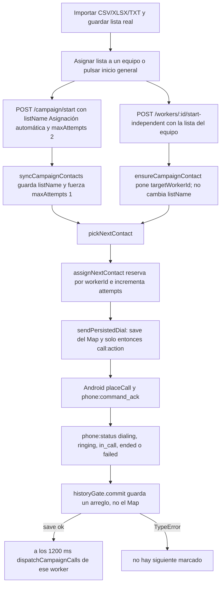

# Informe de concurrencia de llamadas

Auditoría estática del árbol de trabajo de este repositorio. No se modificó la aplicación, no se llamó a ningún teléfono, no se tocó MySQL ni se desplegó la APK. Los tamaños de `llamadas1`, de los JSON de `sessions` y de los binlogs son antecedentes comunicados, no mediciones de esta pasada.

## 1. Resumen ejecutivo y alcance

El síntoma pedido es: tras unas 10–20 llamadas, uno o más Xiaomi dejan de marcar, a veces mientras otro sigue, incluso con listas distintas. En este código no existe un tope de 10 ni de 20 contactos. Lo que sí está escrito es una cadena que se detiene sola y un filtro que puede impedir el marcado desde el inicio.

Dos defectos están confirmados por el código y explican una parada silenciosa:

1. Cada `phone:status` guarda la sesión con un arreglo y `SessionPersistence.save` solo acepta un `Map`. Esa llamada lanza `TypeError` antes de escribir. El siguiente marcado solo se programa dentro del callback que corre si ese guardado termina bien. La progresión automática queda cortada en el primer estado que pasa por esa puerta.
2. El inicio general nombra la campaña `Asignación automática`, y el selector solo toma contactos cuya lista se llama exactamente así. Las listas reales no coinciden. Ese inicio no puede elegir el contacto siguiente.

El patrón “funciona 10–20 veces y luego se congela” no quedó reproducido. Con el defecto 1, la cola automática se corta en el primer estado, no en la llamada 10. Si en producción se observan más llamadas, esa instancia no está ejecutando este `call-history-gate.js`, o hay otro proceso disparando el despacho. Eso queda como desconocido.

Alcance leído: importación en `frontend/features/contacts/import/import-actions.js`, inicio general y por equipo, `backend/services/campaigns/campaign-manager.js`, `backend/services/calls/dispatcher.js`, `backend/shared/persistence.js`, `backend/services/calls/call-history-gate.js`, `backend/sockets/call-events.js`, `backend/sockets/utility-events.js` y `android-app/app/src/main/java/com/voipvc/bridge/BridgeService.kt`. Versión del paquete: `0.1.0`. No hay prueba automática de `pickNextContact` ni del argumento que `commit` pasa a `save`.

## 2. Mapa de flujo

Límites de exclusión que sí existen:

| Límite | Dónde | Efecto |
| --- | --- | --- |
| Global de proceso | `saveChain` en `backend/shared/persistence.js:30` y `:207` | Un guardado de cualquier sesión espera al anterior. Dos sesiones no escriben en paralelo. |
| Por sesión | `CallHistoryGate.serialize` en `backend/services/calls/call-history-gate.js:15` | Los `phone:status` de una sesión entran en fila. |
| Por worker | `campaign.assignments[workerId]` en `campaign-manager.js:448` | Un equipo no recibe otro contacto mientras conserve asignación. |
| Por dispositivo físico | `bindDeviceToPairingSlot` en `pairing-lifecycle.js:19` | El socket viejo del mismo slot se desconecta. No hay un candado entre sesiones distintas. |
| Por lista | solo si `campaign.listName` coincide con `contact.list` | No aísla las listas entre sí cuando el nombre de campaña es el rótulo general. |
| Campaña | una campaña `running` por sesión, tope 10000 contactos | `backend/routes/campaigns.js:50` y `:53` |

## 3. Matriz de conflictos

| ID | Severidad | Síntoma | Evidencia | Reproducción | Impacto | Confianza |
| --- | --- | --- | --- | --- | --- | --- |
| C1 | Crítica | La campaña no pasa a la llamada siguiente | `call-history-gate.js:39` pasa `[session]` a `save`. `persistence.js:202` hace `for (const [code, session] of sessionsMap)`. Un arreglo de un objeto lanza `TypeError` porque el objeto no es iterable. El siguiente despacho está en `call-events.js:282-283`, dentro del callback de `commit` (`call-history-gate.js:41`). | Aislada: el mismo `for...of` con un arreglo de un objeto lanza `TypeError`. No se levantó el servidor ni se hizo una llamada. | El ACK de estado sale con `persisted: false` (`call-events.js:293-296`). La asignación ya se mutó en memoria y el intento queda abierto en MySQL si el último `save` bueno fue el del marcado. Al reiniciar, `assignments[workerId]` sigue presente y `dispatcher.js:188` no le da otro contacto. | Confirmado por código y por la prueba de lenguaje. No reproducido con teléfonos. |
| C2 | Crítica | El inicio general no marca, o marca cero | `campaign-controller.js:224-236` envía `listName = "Asignación automática"`. `campaigns.js:70-72` lo guarda. `campaign-manager.js:420` exige `contact.list === campaign.listName`. Los contactos llevan la lista del archivo (`import-actions.js:56-58`, `contacts-repository.js:370`). | No ejecutada. El predicado no tiene excepción para ese rótulo. | `dispatched.length` queda en 0. La UI dice que ningún equipo estaba disponible (`campaign-controller.js:250-252`), que no es la causa. | Confirmado por código. No reproducido en UI. |
| C3 | Alta | Un Xiaomi se queda con la lista de otro | `dispatcher.js:175-179` borra `targetWorkerId` de pendientes cuyo worker no está en el conjunto conectado. `campaign-manager.js:417-418` activa `targetedMode` si cualquier contacto tiene dueño. `campaign-manager.js:427-435` entrega la lista entera sin dueño al primer worker que se queda sin contactos propios. | No ejecutada. | Un corte de socket, aunque sea corto, suelta la lista. El otro equipo la absorbe. El primero, al volver, ya no tiene contactos con su id. | Confirmado por código. La frecuencia del corte es hipótesis. |
| C4 | Alta | Reintento distinto al que muestra el panel | El panel envía `maxAttempts: 2` (`campaign-controller.js:236`, `shift-actions.js:34`). `campaigns.js:72` escribe `maxAttempts: 1`. `campaign-manager.js:677-686`: si `attempts < maxAttempts` pasa a `retry_pending`; si no, a `failed`. | No ejecutada. | Un no contesta cierra el contacto en el primer intento. No explica por sí solo una pausa a mitad de lista. | Confirmado por código. |
| C5 | Alta | Todos los equipos esperan la misma escritura | `sendPersistedDial` espera `persistence.save` de la sesión completa antes de `call:action` (`dispatcher.js:40-75`). `save` clona la sesión con `JSON.parse(JSON.stringify)` (`persistence.js:205`) y reescribe la fila JSON (`persistence.js:262-264`). `saveChain` es una sola promesa del proceso (`persistence.js:207-217`). `saveSoon` dispara a los 150 ms (`session-state.js:42-58`) y, si no hay códigos sucios, guarda todas las sesiones. | No medida. | Con JSON de decenas de MB, cada estado y cada marcado reescriben la fila. Dos a seis teléfonos, y también dos sesiones, se serializan. Puede parecer que uno llama y el otro se paraliza. Un `UPDATE` largo no tiene tope de tiempo de consulta, solo `connectTimeout` de 10 s (`persistence.js:22`). | Mecanismo confirmado. La relación con los ~76 GB de binlogs es correlación, no causalidad medida. |
| C6 | Media | El equipo queda en `dialing` aunque Android rechazó la orden | `phone:command_ack` solo registra y reenvía (`call-events.js:310-330`). No suelta la asignación ni pide otro contacto. Android rechaza si `activeCommandId` sigue puesto (`BridgeService.kt:640-643`). El backend ya puso `worker.callState = "dialing"` y la asignación (`dispatcher.js:196-212`). El filtro de `dispatcher.js:187-188` exige estado `idle`, `ended`, `failed` o `available` y asignación vacía. | No ejecutada. | El rechazo no recupera la cola. El teléfono local sí limpia el tracking al observar `ended` o `failed` (`BridgeService.kt:1098-1112`), así que el rechazo permanente depende de que ese estado físico no llegue. | Confirmado por código. |
| C7 | Media | Al caer el socket no hay siguiente llamada | Si el worker sigue en `dialing`, `ringing` o `in_call` a los 12 s, `utility-events.js:184-197` marca `ended` y no llama a `dispatchCampaignCalls`. | No ejecutada. | El contacto puede cerrarse y el equipo quedarse en `idle` sin continuar la lista. | Confirmado por código. |
| C8 | Baja | El mismo aparato en dos sesiones | El reemplazo de slot es por sesión (`pairing-lifecycle.js:19-31`). No hay índice global de `deviceId`. | No ejecutada. | Dos sesiones podrían ordenar el mismo Xiaomi. | Hipótesis. No hay evidencia de que ocurra en este árbol. |
| C9 | Informativa | No hay tope 10–20 | El tope de campaña es 10000 (`campaigns.js:53`). El archivo de reportes recorta a 100 (`dispatcher.js:269-271`). Android usa 10 s sin estado Telecom (`BridgeService.kt:697-710`), 20 s y 40 s de marcado (`BridgeService.kt:1073-1085`) y latido de 10 s (`BridgeService.kt:1357-1382`). | Búsqueda estática. | Esos números son tiempos por llamada, no un contador de contactos. | Confirmado que no hay ese contador. |

## 4. Listas generales, listas exclusivas y 2 a 6 Xiaomi

Inicio general (`campaign-controller.js:212-246`): junta todos los contactos con teléfono válido que no estén `completed`, `failed`, `awaiting_callback` ni `no_contactado`. Si la lista del contacto está en el mapa local de equipos, le pone `targetWorkerId`. Si no, lo deja sin dueño. El nombre de campaña es siempre el rótulo `Asignación automática`.

Por el filtro de `campaign-manager.js:420`, ese inicio no selecciona contactos de listas reales. `targetedMode` ni siquiera llega a decidir.

Inicio por equipo (`device-controls.js:96-121` y `devices.js:152-183`): manda solo la lista de ese slot y el backend les pone `targetWorkerId`. No cambia `listName`. En una campaña nueva, `listName` está vacío (`campaign-manager.js:59`) y el filtro deja pasar. Cada worker solo recibe contactos con su id (`campaign-manager.js:418`). Ese es el único camino de este árbol en el que dos listas pueden avanzar a la vez, y solo hasta el primer `phone:status`, por C1.

Si cualquier contacto tiene dueño, los demás workers no toman contactos ajenos. La excepción es C3: al borrar el dueño de un desconectado, el siguiente worker que agota su lista se apropia de toda la lista libre, no de un contacto (`campaign-manager.js:432-435`). Con 2 a 6 teléfonos el efecto es el mismo: un solo worker absorbente y el resto sin elegibles. No hay una cola por dispositivo fuera de `assignments` y `targetWorkerId`.

`switchWorkerList` (`campaign-manager.js:582-623`) sí mira si otro worker conectado está en llamada sobre la lista destino. No mira una asignación pendiente. Puede reetiquetar contactos `pending` de una lista que otro equipo todavía no ha marcado.

El modo general y el modo por equipo comparten una sola campaña y un solo objeto `assignments`. No hay seis colas independientes.

## 5. MySQL, colas y binlogs

Qué hace cada marcado y cada estado:

1. `sendPersistedDial` clona la sesión y entra a `saveChain` (`dispatcher.js:40`, `persistence.js:197-217`).
2. `saveNow` abre transacción, lee la fila, compara el JSON completo y hace `INSERT ... ON DUPLICATE KEY UPDATE` de toda la columna `data` (`persistence.js:250-274`).
3. Los intentos sucios se escriben en `vc_call_attempts` con `SELECT ... FOR UPDATE` por intento (`call-history.js:115-118`).
4. `phone:status` vuelve a pedir un guardado durable antes del recibo y del siguiente marcado (`call-events.js:256-283`). Ese guardado es C1: no llega a la transacción.

`historyGate.blocked` siempre devuelve `false` (`call-history-gate.js:12-14`). No frena el despacho. La frase de `dispatcher.js:164` no protege nada.

No se midió `persistMs`, ni bytes por escritura, ni binlog por hora. El mecanismo alcanza para hacer crecer el binlog si el formato es por filas y la columna JSON se reescribe entera en cada estado: el binlog guarda la imagen de la fila, no el diff del contacto. Los ~18 MB y ~20 MB citados harían cada `UPDATE` muy caro. No está demostrado que esas dos filas hayan producido los ~76 GB. Tampoco se demostró que el purgado a 3 días haya quitado la causa; solo el síntoma de disco. No hay respaldo externo en este árbol que se pueda dar por verificado.

`lastSnapshot` se sustituye por el snapshot parcial del `save` (`persistence.js:237`). Un guardado de una sola sesión deja el respaldo en memoria sin las demás. Eso afecta a `backup()`, no a la tabla, porque cada fila se escribe por su código.

La comparación `JSON.stringify(existingData) === JSON.stringify(data)` (`persistence.js:261`) puede fallar por el orden de claves que devuelve el driver y forzar una reescritura aunque el contenido sea el mismo. Es hipótesis, no se ejecutó contra MySQL.

## 6. Android, aparte del backend

`call:action` llega a `BridgeService.kt:519`. `dial` deduplica por `commandId` (`:540-557`) y llama a `TelecomManager.placeCall` (`:686-691`). El ACK de Socket.IO no lo usa el servidor (`dispatcher.js:71-75`); el teléfono manda `phone:command_ack` (`BridgeService.kt:1458-1469`). El servidor no actúa sobre ese ACK (C6).

Estados físicos: `dialing`, `ringing`, `in_call`, `ended`, `failed`. Un `idle` de campaña se informa como `ended` si había llamada de campaña (`BridgeService.kt:1054`). El backend solo suelta al worker con `ended` o `failed` mientras el contacto sigue en estado activo (`campaign-manager.js:660`). Un `idle` sin `terminalConfirmed` no libera (`call-events.js:224` y `campaign-manager.js:657-659`).

Buzón: `detectedVoicemail` y `detectedAnnouncement` viajan en `phone:status` (`BridgeService.kt:1547-1549`). El backend anota `buzon_de_voz` en el intento y solo cierra el contacto cuando llega el estado terminal (`campaign-manager.js:637-670`). Shizuku y Vosk no participan en la decisión de soltar la cola. Si el buzón se detecta y el `ended` no llega, el worker sigue ocupado por la regla de estado terminal, no por el reconocedor.

Latido: ping cada 10 s; si el pong tarda más de 5 s, el teléfono corta el socket (`BridgeService.kt:1377-1382`). Un `save` lento puede alargar el pong. Es una hipótesis de desconexión, no una prueba de que el latido sea la causa de las paradas.

Recuperación: al reconectar se reemite el último estado (`BridgeService.kt:480-484`). El tracking se limpia en el teléfono al ver el fin (`:1110-1112`) y también si el ACK dice `accepted` y `terminal` (`:499-506`). El servidor no vuelve a marcar por ese ACK.

## 7. Correcciones por fases

No implementar hasta aprobación explícita. Hace falta un respaldo externo verificable antes de cualquier escritura de reparación.

Fase 1, sin cambiar la durabilidad del intento:

- `commit` debe guardar `this.getSessions()` o un `Map` con el código real. Hoy el arreglo ni identifica la sesión ni es iterable como pares.
- El siguiente marcado debe seguir esperando a que ese `save` confirme. No emitir `call:action` ni avanzar la cola si el guardado falla.
- Tratar `Asignación automática` como “sin filtro de lista”. El filtro literal solo debe aplicarse cuando `listName` es una lista real, como `Pendientes del turno` si esa lista también existe en los contactos. Hoy `Pendientes del turno` tiene el mismo problema: los contactos conservan su lista original (`shift-actions.js:39`) y el filtro exige igualdad (`campaign-manager.js:420`).
- Dejar de borrar `targetWorkerId` por no aparecer en el snapshot de conectados. Una desconexión no transfiere la lista. La apropiación de `campaign-manager.js:427-435` no debe correr mientras el dueño anterior pueda reconectar.
- Una sola fuente para `maxAttempts`. El `1` fijo de `campaigns.js:72` ignora el `2` del panel.

Fase 2, después de medir una campaña de prueba:

- Seguir guardando el intento en `vc_call_attempts` dentro de la transacción. Reducir la reescritura del JSON de sesión a los campos que de verdad cambiaron, sin perder el orden de `saveChain` ni marcar un intento que no quedó escrito.
- Si Android responde `phone:command_ack` con `ok: false`, soltar la asignación solo cuando el estado físico no esté en llamada, y volver a encolar ese contacto sin sumar otro intento si `placeCall` no llegó a ocurrir.
- Al cumplirse la gracia de 12 s, programar el despacho de ese worker igual que hace el estado terminal.
- Pruebas de `pickNextContact`, de `commit` con `Map`, y de dos workers con listas distintas.

No conviene empezar por purgar binlogs, borrar sesiones ni tocar Shizuku.

## 8. Plan de pruebas

No se ejecutó ninguna. Resultados observados: solo el `TypeError` del bucle equivalente al de `save`. El resto es resultado esperado.

| Prueba | Esperado si el código sigue igual | Esperado después de la fase 1 |
| --- | --- | --- |
| 1 teléfono, 20 contactos, una lista, sin llamadas reales: simular `phone:status` `ended` | El `commit` falla y no hay segundo `call:action` | 20 marcados, un intento cada uno, sin duplicar `attemptId` |
| 2 teléfonos, 2 listas, 20 contactos cada una | El inicio general marca 0. El inicio por equipo marca el primero de cada uno y se detiene en el primer estado | Cada lista avanza solo en su equipo |
| 6 teléfonos | Misma parada, más espera en `saveChain` | Ningún equipo espera el estado de otro para elegir su propio contacto. La escritura sigue ordenada. |
| Cortar el socket durante `dialing` y reconectar antes de 12 s | La lista puede quedar sin dueño y pasar al otro equipo | La lista sigue en el equipo original |
| Perder el `ended` | El worker queda ocupado | Sigue ocupado hasta estado físico o hasta la gracia, y luego continúa sin duplicar |
| MySQL lento | `saveChain` retrasa a todas las sesiones. No se midió | Se registra `persistMs` y `queueWaitMs`. El marcado no sale antes del commit |
| Buzón | El contacto no se cierra hasta `ended` o `failed` | Igual. Shizuku no decide la cola |
| Mismo `deviceId` en dos sesiones | No hay candado global | Hay que añadir la prueba antes de afirmar que está prohibido |

Medidas a agregar en esa prueba, sin datos personales: `sessionCode`, `workerId`, `contactId`, `callId`, `commandId`, lista, `persistMs`, `queueWaitMs`, `dispatchMs`, tiempo hasta ACK, tiempo hasta terminal, `nextDialMs`, profundidad de `saveChain` y bytes de binlog por hora.

## 9. Respaldo, despliegue y rollback

No hay respaldo externo confirmado. No desplegar la corrección ni ejecutar una campaña de reparación sobre `llamadas1` hasta tener una copia restaurable y probada fuera de este servidor.

Despliegue propuesto, cuando se apruebe: primero el arreglo de `commit` y el filtro de lista, en un proceso nuevo, con las sesiones actuales solo en lectura. Verificar con la prueba de 2 teléfonos. Después el aislamiento de `targetWorkerId`. La reducción del JSON queda en una tercera salida.

Rollback: volver al build anterior del proceso Node. No hace falta migración de esquema para la fase 1. No borrar filas de `sessions` ni de `vc_call_attempts` para revertir. Si una campaña de prueba dejó asignaciones `dialing` huérfanas, el rollback de código no las limpia; hay que decidir un cierre explícito con el intento ya escrito, no un borrado.

## 10. Preguntas abiertas

- ¿El proceso que hoy llama en producción tiene este `call-history-gate.js:39`? Si allí se completan más de una llamada automática, no es este archivo.
- ¿El operador usa el botón general o el botón por equipo? El primero, en este árbol, no elige contactos.
- Tamaño real de cada `sessions.data`, frecuencia de `UPDATE` y `binlog_format` durante una campaña. Sin eso, los 76 GB siguen siendo correlación.
- Si el Xiaomi emite `ended` con el mismo `callId` de la asignación. Sin ese par, `updateActiveCallState` no suelta al worker (`campaign-manager.js:630` y `:636`).

## 11. Checklist de aceptación

- Cero llamadas duplicadas: un `attemptId` activo por contacto y un `commandId` no reutilizado para un `placeCall` nuevo.
- Cero contactos perdidos: un `pending` o `retry_pending` sigue elegible para su worker después de un fallo de guardado, y no pasa a otra lista.
- Progreso independiente: el estado de un Xiaomi no borra el `targetWorkerId` de otro ni elige contactos de su lista.
- Sin bloqueo indefinido: un terminal confirmado, o la gracia de desconexión, siempre programa el siguiente marcado de ese worker. Un `commit` fallido no deja la asignación tomada en memoria y abierta en MySQL.
- El panel y el servidor usan el mismo `maxAttempts`.
- Ningún marcado sale antes de que MySQL confirme el intento.

## Cierre

**Demostrado:** el guardado de `phone:status` no puede completar porque recibe un arreglo donde `save` exige un `Map`, y por eso la cola automática no programa la llamada siguiente. El inicio general filtra por el nombre `Asignación automática` y no por las listas importadas. El servidor fuerza un intento aunque el panel pide dos. Desconectar a un equipo puede soltar su lista y otro equipo se la queda entera. Todas las sesiones comparten `saveChain` y reescriben el JSON completo.

**No demostrado:** que el corte ocurra a las 10–20 llamadas, que los JSON grandes hayan generado los 76 GB, y que Shizuku, Vosk o la batería del Xiaomi sean la causa.

**Corregir primero:** el argumento de `commit`, el filtro del rótulo general y la cesión de lista al desconectar.

**No tocar todavía:** binlogs, borrado de sesiones, la APK, ni la regla de esperar el guardado antes de marcar.
